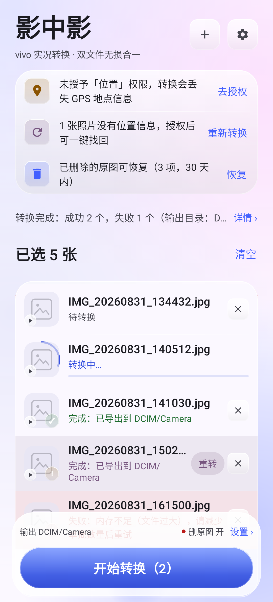
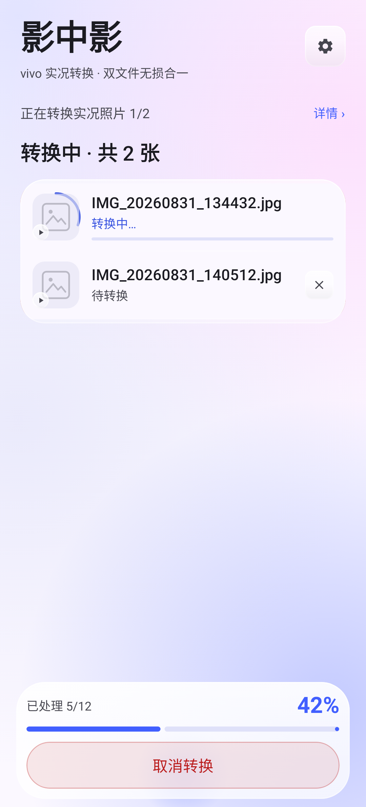
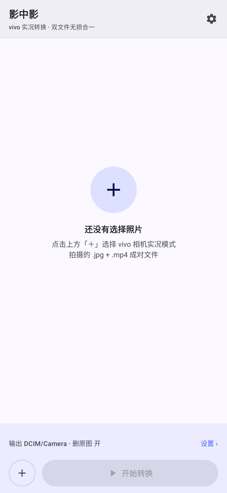
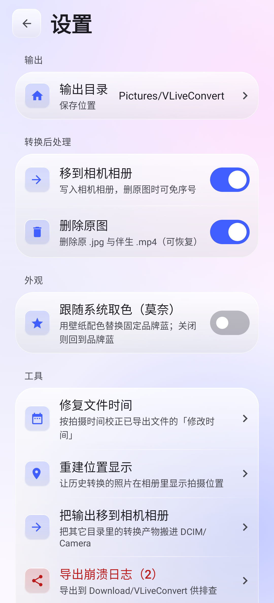
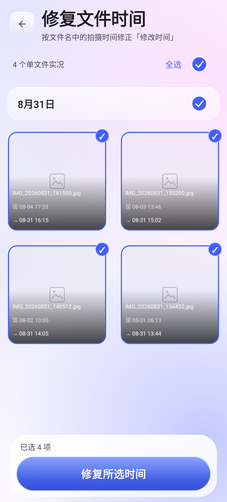
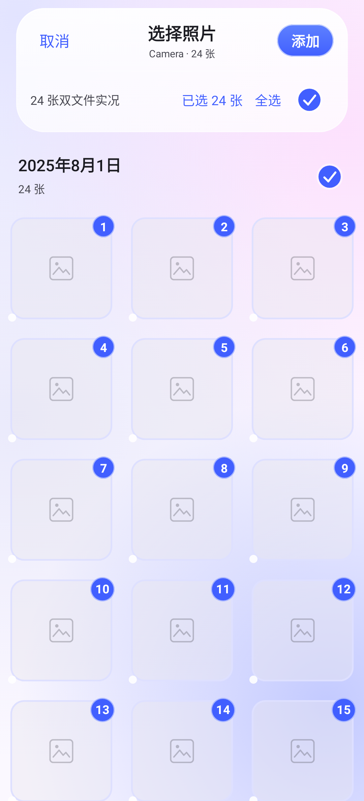
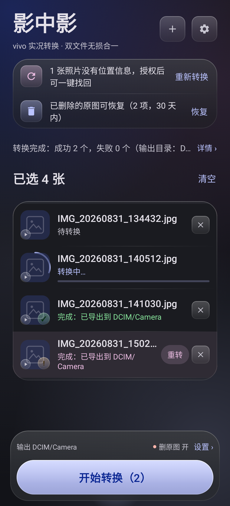
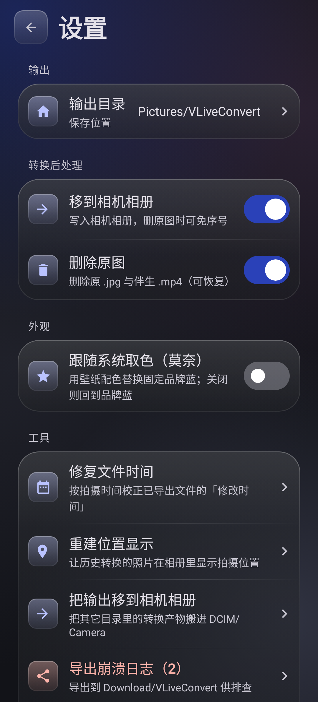

# 影中影（Vivo Live Photo yuting改进版）

**vivo 实况转换工具**：把 vivo 相机实况模式生成的两个文件（.jpg + .mp4）字节级无损合并成一个
单文件实况（Android）。——把一段会动的时光，收进一张照片。

> 一张照片（影）里，封着一段影像（影），故名「影中影」。原名「Vivo Live Photo（yuting改进版）」，
> 是 [brovast/VLiveConvert](https://github.com/brovast/VLiveConvert) 的改进版（v2.0.0），
> 基于 GPL-3.0 协议继续开源，改进内容见文末「改进版变更记录」。
>
> **下载 APK**：[Releases 页面](https://github.com/yuting-ou/VivoLivePhoto/releases/latest) ——
> 点开 `VivoLivePhoto-v2.2.0.apk` 即可直接安装（推荐）。亦可从仓库根目录
> [`VivoLivePhoto-v2.2.0.apk`](./VivoLivePhoto-v2.2.0.apk) 下载，内容一致。
>
> **v2.2.0 起界面整体重构为液态玻璃**（Backdrop 实时折射 + Haze 模糊），已经 vivo X200
> Ultra 真机九轮迭代验证；转换核心与数据逻辑零改动。有问题可回退
> [v2.1.0](https://github.com/yuting-ou/VivoLivePhoto/releases/tag/v2.1.0)。
>
> **安装说明**：v1.7.8 起更换了应用包名（`com.yutingou.yingzhongying`），与原版及各改进版
> **互不冲突、可并存安装**——此前若提示「软件包与现有软件包存在冲突 / 开发者签名异常」，
> 是因为旧版本同包名但签名不同；安装本版无需卸载任何已装应用。

## 截图

| 主界面 | 转换中 | 空状态 |
|---|---|---|
|  |  |  |

| 设置 | 修复时间 | 选择照片（日期分段） |
|---|---|---|
|  |  |  |

| 深色主界面 | 深色设置 |
|---|---|
|  |  |

（截图由 JVM 单测真实渲染产出，与安装包同源；Robolectric 无硬件加速，截图中的玻璃是
不透明回退膜，真机/模拟器上由 Haze 实时采样并模糊玻璃下方的照片。转换完成有角标弹入
与底栏交叉过渡动效）

## 背景

vivo 相机拍的「实况」其实是两个文件：IMG_xxx.jpg + IMG_xxx.mp4。双文件在实际用起来痛点不少：

- 换机、网盘、第三方传输工具经常把 .mp4 落下，实况秒变普通照片
- 微信等聊天工具发出去实况直接失效
- 部分第三方相册 / 壁纸应用不认双文件

## 这是什么

VLiveConvert 把 vivo 双文件实况转成「单文件实况」——一个 .jpg 内嵌视频，等同于 vivo 相册「关闭实况」时自动合并的产物。转换后：

- ✅ vivo 相册仍识别为实况，按压可播放
- ✅ 字节级无损：不重编码，EXIF（拍摄参数 / 镜头 / GPS / 拍摄时间）原样保留
- ✅ 标准 Google Motion Photo 结构，支持单文件动态照片的第三方相册也能读

## 功能

- 🧊 液态玻璃界面：浮动玻璃导航与 Dock、玻璃弹窗与撤销条、日期分段标题，Backdrop 实时折射 + Haze 模糊，深浅色自适应
- 📷 内置选择器：自动扫描相册，只列出双文件实况照片（普通实况、人像实况都支持），普通照片不掺杂
- ⚡ 批量转换，按内存动态并发
- 📥 转换后自动移入相机相册：导出文件直接写入 `DCIM/Camera`（重名自动追加序号，可关闭）
- 🕐 修改时间对齐照片时间：导出文件的「修改时间」取自照片拍摄时间（EXIF / 文件名）；历史已转换文件可在主界面「修复时间」中多选批量修正
- 🗑️ 可选「转换后删除原图」：原 .jpg + 伴生 .mp4 一并处理（可选静默删除或系统回收站）
- 📦 APK 仅 2.5MB，全程本地处理，不联网、不上传任何数据

## 使用流程

1. 首次启动授予「照片和视频」权限（视频权限必须，否则找不到伴生 MP4）
2. 内置选择器自动扫描相册，只显示双文件实况照片
3. 选择照片 → 「开始转换」→ 单文件实况输出到相册 `Pictures/VLiveConvert`（修改时间与照片时间一致）
4. 可选开启「转换后删除原图」：转换成功后删除原 .jpg 与伴生 .mp4
   - 授予「所有文件访问权限」（推荐）：删除立即执行、无确认框，被删文件进入 vivo 相册「第三方删除拦截」，可在相册恢复
   - 不授权：每次删除前系统弹「移入回收站」确认框，文件以隐藏形式保留 30 天，可在本应用「恢复原图」入口恢复
5. 同名输出由 MediaStore 自动追加序号，不会覆盖已有文件
6. 历史转换的文件修改时间不对？主界面右上角「修复时间」→ 多选 → 一键按文件名时间修正

## 已知说明

- 需要 Android 14 及以上（OriginOS 5 / 6 机型）
- **已在 vivo X200 系列机型真机实测**：普通实况 + 人像实况无损转换、相册动图识别、位置显示（v2.0.1 起）与历史照片位置重建（v2.0.2）全链路验证通过
- 其它机型/系统版本欢迎反馈「机型 + 系统版本 + 结果」

## 转换原理（无损转换，不重编码）

输出结构（与 vivo 相册「关闭实况」合并产物逐字节对齐，经真机实测可被识别）：

```
[JPEG 主体 Primary + GainMap][streamdata 附加块][MP4 视频流][lpex box][convert footer]
```

关键处理：

| 步骤               | 说明                                                                                                                                                                                      |
| ------------------ | ----------------------------------------------------------------------------------------------------------------------------------------------------------------------------------------- |
| 视频 uuid box 处理 | 保留`vivoMediaEStream`（旧机型实况标识，X200 Ultra 起已无）；剥掉 `vivoMediaExtInfo`（内嵌的源 footer 包装，与尾部 convert footer 重复会破坏识别）                                    |
| streamdata 附加块  | 源 JPG 中紧跟图像数据的 vivo 私有流，原样透传：普通实况约 114B（DEGS 流信息）；人像实况约 4MB（IAC 深度/虚化数据，丢失则相册不显示人像徽标、无法后编辑光圈/虚化）                         |
| lpex box           | 向`moov` 插入 LivePhotoExtension box（含封面帧时间戳等），并修复 stco/co64 偏移；缺 lpex 不被识别                                                                                       |
| convert footer     | 尾部追加`cameralbum!` footer（`com.vivo.gallery.file.convert=10004` 等），透传 imageTime，并合并源 JPG/MP4 footer 的全部附加字段（人像: `moduleid=portrait`、`joint.refocus` 等） |
| XMP                | Google Container（Primary/GainMap/MotionPhoto 视频项）+ VCamera 私有字段，`GCamera:MotionPhoto="1"`                                                                                     |
| 封面帧             | 由源 footer 的 imageTime（帧序号）按视频 fps 反推 PTS                                                                                                                                     |

## 双文件实况识别（内置选择器）

判定链（从严，避免误收录）：

1. `.jpg/.jpeg` 扩展名
2. 同目录存在同名 `.mp4` 且非空
3. XMP 无 `MotionPhoto`/`MicroVideo` 内嵌标记（排除 Google/OPPO/小米等单文件内嵌格式）
4. JPG 尾部能解析出含 28 字符 livephoto ID 的 `cameralbum!` footer

footer 尾部长度可变：普通实况 ID 字段 28 字符（tail 43B）；vivo X200 Ultra 人像实况
ID 字段前多 12 字节二进制（tail 55B，len2 字段语义已变）。解析器按 len2 试探、
失败回退「尾部直取到文件尾」，以末尾 FF 分隔 + magic 校验兜底。

注：X200 Ultra 双文件 MP4 已不含 `vivoMediaEStream` uuid box（旧 iQOO 格式才有）；
识别核心为 lpex box + convert footer + XMP。

## 代码结构

```
app/src/main/java/com/vliveconvert/app/
├── MainActivity.kt          # 权限流、选择器集成、转换调度、MediaStore 导出
├── core/                   # 无损核心（无 Android 依赖，可 JVM 单测）
│   ├── BinaryUtils/JpegUtil/Mp4Util/FooterUtil   # 大小端、JPEG 段、ISOBMFF box、cameralbum footer
│   ├── XmpTemplate.kt       # vivo 单文件实况 XMP 模板（逐字取自真机样本）+ XMP 定位
│   ├── LivePhotoAsset.kt    # 动态照片规范化表示
│   ├── VivoDual.kt          # 双文件识别 + 解析
│   └── VivoSingle.kt        # 单文件写出（uuid 剥离、lpex 合成、footer/XMP 拼装）
├── convert/Converter.kt     # 管线：detect → read → write
├── picker/                  # 内置选择器：MediaStore 直查 + 会话化多线程扫描（只收录双文件）
└── ui/                      # Compose 界面：主列表 / 设置页 / 权限引导 / 修复时间 / 液态玻璃设计系统
```

## 改进版变更记录

### v2.2.0（液态玻璃 · 界面全面重构）

**纯界面重构，转换核心与数据逻辑零改动。** 目标是 iOS 26 风格的「液态玻璃」：
真实背景采样折射 + 半透明分层 + 顶缘高光 + 折射描边 + 环境阴影，深浅色分别取膜。
经 test1~test9 九轮真机迭代打磨定稿。

- **真实折射**：接入 [Backdrop 1.0.2](https://github.com/Kyant0/AndroidLiquidGlass)
  （Kyant0，Apache-2.0）。页面内容录进 GraphicsLayer，玻璃用 AGSL 按**圆角矩形 SDF**
  做边缘压缩折射，叠加方向性高光、内阴影与色散；[Haze 1.6.10](https://github.com/chrisbanes/haze)
  负责背景模糊（均 Apache-2.0，关于页已声明）
- **浮动玻璃导航/Dock**：从列表布局中拆出、悬浮在内容上方，照片从玻璃下方穿过；
  列表底部留出滚动余量，最后一行仍能完整滚出
- **玻璃弹窗**：11 个系统 `AlertDialog` 全部替换为应用内玻璃浮层（同窗口才能采样折射），
  长文案可滚动、按钮固定底部、2× 字号自适应、弹簧入场动效；弹层纳入统一返回优先级，
  返回键/点外部只关弹窗
- **玻璃撤销条**：移除/清空的撤销条与整体玻璃语言一致
- **相册切换面板**：选择器点标题弹出玻璃底部面板（弹簧动效），封面缩略图 + 相册名 +
  张数 + 当前相册勾选，替代原先光秃秃的下拉菜单
- **日期分段**：每个日期一张分段标题（日期 + 张数 + 整天全选圆圈），标题随内容滚动，
  不会被浮动导航遮住
- **清晰预览**：待转换照片直接显示清晰缩略图；完成条目优先用导出产物 URI 加载
  （源文件被移走/删除后旧 URI 失效会破图）
- **12dp 网格 + 同心圆角**：卡片 24 / 浮动玻璃 28 / 撤销条 20 / 磁贴·缩略图·网格 12
  （选中 16）/ 行内微元素 8 / 按钮胶囊；图标磁贴为方圆角玻璃
- **视觉对齐**：内容页 20dp、悬浮玻璃 16dp 留白体系；分组标签对齐磁贴左缘（32dp）；
  分隔线与文字左缘对齐（58dp）；二级页标题统一 28sp
- **深浅色双膜**：深色「暗烟玻璃」加厚底膜，亮背景文字仍可读；未选勾选框描边加深
- **许可合规**：关于页第三方组件声明 Haze / Backdrop 及 Apache-2.0 完整文本
- **测试与性能**：全量 180 条 JVM 用例通过（4 条按平台跳过）；Robolectric 自动走不透明
  回退膜；模拟器发布包滚动 ~300 帧、jank <1%、99 分位 ~26ms；2× 字号全量走查
- 已知：README 截图是 JVM 回退膜（无硬件折射），真机才看得到实时玻璃效果

### v2.1.0（全选不再卡死 + 清空可撤销 + 大字号适配）

**一轮真机实测驱动的性能与可达性修复**（测试机：vivo X200 Ultra，360dp 宽；
相机相册 19287 张、其中双文件实况 8550 张）：

- **全选卡死（ANR）**：选择器全选 8550 张时，旧实现对每个格子/日期头都线性扫
  已选列表（O(n²)），且逐张 `add` 触发八千次快照通知，主线程被打满、系统判定
  ANR。改为派生 id 集合 + 序号表（O(1) 查询）、整组一次 `addAll`；
  「全选」文字本身也可点
- **添加卡死（ANR）**：确认添加时逐张查重（同为 O(n²)）、逐张 `add`，并在主线程
  序列化两万级队列 JSON。改为 id 集合去重 + 一次 `addAll`，队列落盘移出主线程
- **清空可撤销**：清空待转换列表后弹 10 秒「撤销」，原位恢复列表与落盘队列；
  清空后新加的照片保留、同 id 不重复（不删除任何照片文件）
- **撤销条主题化**：默认 M3 Snackbar 是反相近黑色，与莫奈浅色卡片体系割裂；
  改为与卡片同语言的浮层（14dp 圆角、surfaceContainerHigh 底、细描边 + 阴影、
  主题色动作），单项移除与清空共用
- **大字号**：2× 字号下底栏安全信息「删原图 开/关」不再被省略号吞掉（最多两行）；
  设置页「输出目录」标题不再被固定 150dp 的值列挤成竖排（值列随字号收缩，
  正常字号显示不变）
- 实测：主列表滚动 882 帧、jank 0.00%（legacy 0.11%）；选择器网格滚动 890 帧、
  jank 0.00%（legacy 0.79%）；全选 8550 张约 3 秒、添加约 3 秒，均无 ANR
- 测试：选择器全选/取消全选（300 张规模）UI 用例、清空撤销合并语义 3 条 +
  真实点击链路 1 条

### v2.0.9（动效与触觉打磨）

**一轮纯表现层的手感打磨**（功能与数据逻辑零改动）：按 Apple / Emil Kowalski 的界面
设计原则，把「按下有回应、入场更利落」落到每个可交互元素。

- **入场统一强 ease-out 曲线** `cubic-bezier(0.23,1,0.32,1)`，退场一律更快——
  缩略图、状态摘要、空列表切换、底栏与页面转场
- **按压反馈**：开始/取消转换、添加、空状态大＋、内联文字按钮、设置卡片按下轻微回弹；
  状态摘要整行按下变淡
- **触觉反馈**：批次完成、单项失败（与红抖同帧）、滑动删除提交各给一次系统触觉
- 进度弹簧更跟手（240→360），单项转圈 1100→900ms

### v2.0.8（重建工具副作用警告）

**把行重建的不可逆副作用摆到操作者面前。** 重建会把照片的「加入相册时间」
（MediaStore `date_added`）重置为操作当天——该列由系统强制托管，应用、shell、
系统恢复等十余种写入路径实测均无法改写，微信等按加入时间分组的应用会把这些
照片归入「今天」。

- 重建确认弹窗新增醒目警告（副作用 + 不可恢复）
- README 补「已知副作用（重要）」与 2026-10-18 事故复盘
- 移除内部验证用临时触发口

### v2.0.7（重建工具时间列修正）

真机时间列实验后的收尾：`date_added` 确认不可写；`date_modified` 改走
**非 pending 直插**以保留给定值（走 pending 流程会被插入时刻覆盖）；
`datetaken`（拍摄时间）正常保留。

### v2.0.6（莫奈取色 + 视觉对齐）

- 莫奈取色（Material You）默认跟随系统壁纸配色，设置页「外观」可切回品牌蓝；
  取色失败自动回退，语义色（成功/失败/警告）不参与取色
- 设置页视觉对齐按墨迹实测修正（标签左缘、chevron 右缘、图标重心、副标题防换行）
- 关于页「原始项目 / 本修改版源码」链接可点击（真机验证系统跳转确认后可打开）

### v2.0.5（设置页卡片化 + 滑动删除防误触）

- 设置页全面卡片化：每项一张图标卡 + 一句说明（纯 UI，交互语义不变）
- 滑动删除阈值 50%→60%（半滑自动反弹），移除后弹「撤销」条（10 秒窗口，
  撤销后原位恢复）；撤销条抬到底栏上方，避免被按钮压住
- 依据业界方案：NN/g 要求滑动操作配确认或撤销，Android 官方推荐 Snackbar 撤销

### v2.0.4（清空崩溃日志）

设置页「工具」新增入口：删除全部崩溃日志文件并清空导出去重记录；无日志时置灰。

### v2.0.3（卫生包）

- 输出查重的目录匹配从大小写敏感 `IN` 改为大小写不敏感 `LIKE`（与导出路径
  修复对齐；`%` / `_` 已按 `ESCAPE '\'` 转义）
- 列表项左滑移除（与行内移除按钮同一动作，转换中的项目禁用滑除）
- macOS APFS 大小写不敏感、用例前提不成立的测试按平台跳过——全量测试自此在
  macOS 上也是全绿

### v2.0.2（存量照片位置显示重建）

**给已经转换过的历史照片恢复「相册位置显示」**——真机实测 4699 张全部成功、零失败。

背景：vivo 相册的位置显示只认「出生自带坐标」的媒体库记录（相机拍照时由系统写入）。
应用转换的行没有这个坐标，相册因此不显示位置——而**文件字节里的坐标一直完好**
（全库审计 4452 张 100% 有 GPS；少数老版本产物即使 EXIF 被系统剥掉，坐标也仍写在
自身嵌入视频段的 ©xyz 原子里）。事后直接补写坐标列会被系统静默忽略（实测返回 0 行）。

做法（设置 → 重建位置显示）：

- **行重建**：读字节与元数据 → 删旧记录（文件进「第三方删除拦截」回收站，可恢复）
  → 同名/同目录/同拍摄时间 + 坐标重新插入 → 字节逐字节写回。照片内容、文件名、
  时间戳全部不变
- **视频段恢复**：EXIF 无 GPS 的产物，从自身视频段的 ISO 6709 坐标恢复并写回 EXIF
  （切出 JPEG 单独处理，尾部视频逐字节保留）
- **分批 + 空间守卫**：可用空间低于 10GB 自动暂停，清空回收站后可继续；进度持久化，
  可中断续跑
- 测试：重建字节一致性、坐标写入、无坐标不删记录、空间守卫暂停、续跑跳过已处理
- **⚠ 已知副作用（重要）**：重建会把照片的「加入相册时间」（MediaStore `date_added`）
  重置为操作当天。该列在 vivo ROM 上由系统强制托管——应用、shell、系统恢复等
  六类调用者、十余种写入路径实测均无法改写。因此微信等**按加入时间分组**的应用
  会把这些照片归入「今天」。拍摄时间（EXIF/`datetaken`）、文件时间、vivo 相册
  时间线不受影响。2026-10-18 真机事故复盘：4699 张受影响，无法修复

### v2.0.1（相册位置显示修复）

**修复：新转换的照片在 vivo 相册不显示拍摄位置。** vivo 相册的位置显示读媒体库坐标列、
不回读文件 EXIF（相机拍照时由系统特权写入）。本版起导出三路径（新建插入/原地覆盖/
移入相机回退复制）把源照片坐标随记录写入——新转换的照片相册直接显示位置（真机验证）。

同时修复一个恶性 bug：输出查重的路径匹配区分大小写，与 vivo 相机目录
（`DCIM/camera/` 小写）不匹配时插入同名记录会被系统整行删除、文件变成相册看不见的
孤儿。已改为大小写不敏感匹配（附回归测试）。

### v2.0.0（全新升级）

**1.9 → 2.0 的三件事：最后一个已知限制修掉、动效补齐、真机验证闭环。**

#### 一、跨源同名覆盖（数据安全级，真机验证通过 ✓）

v1.9 以来唯一挂着的已知限制：两个不同目录的同名双文件（如 `DCIM/IMG_1` 和
`Downloads/IMG_1`）先后转入同一输出目录时，第二个会**覆盖**第一个的产物。

修法：产物 XMP 写入**源指纹**（`vlp:sourceFingerprint` = 源 JPEG 的 SHA-256 前 16 位，
自定义命名空间 `vlp`）。再次转换时比对既有产物与当前源的指纹：**同源才覆盖，
异源自动改用 `(1)` 序号新文件**。

**已在真机完成裁决**：2.0.0-test1 转换真实 vivo 实况照片后，相册**仍识别为动态照片**
（徽标与长按播放正常）——指纹是自定义命名空间的附加属性，动图判定的
MotionPhoto 标记 / Container 偏移 / footer 结构原样保留。中间产物（v1.8.x 产物）
没有指纹字段 → 保持既有覆盖行为，向后兼容。

- 测试：指纹注入/提取往返、管线产物携带指纹、**同源同指纹/异源异指纹**合同、
  异源夹具（JPEG 扫描数据翻转——footer/streamdata 都不在指纹输入里，两坑已绕开）

#### 二、动效补齐

- **进度数字滚动**：转换中底栏的百分比与进度条此前按条目跳变，
  现在临界阻尼弹簧平滑追赶（无过冲，100% 恒为 100%）
- 弹窗进出动画：评估后**不做**——M3 `AlertDialog` 不暴露动画参数，
  自行重实现要碰焦点/返回/遮罩，稳定性风险大于收益

#### 三、动效体系全览（1.8.2 → 2.0）

启动画面图标滑入 → 页面切换弹簧转场 → 返回预测性编排（缩出淡出/缩放就位）→
转换中进度滚动 + 旋转环 → 完成「显影」→ 失败抖动 → 列表条目增删动画。
一套液态玻璃语言贯穿始终。

### v2.0.0-test1（测试版 · 源指纹实验，请协助真机验证）

**这是一个测试版**：为修掉最后一个已知限制（两个不同目录的同名双文件先后转入同一
输出目录时，第二个会覆盖第一个的产物），在产物 XMP 里写入**源指纹**
（`vlp:sourceFingerprint` = 源 JPEG 的 SHA-256 前 16 位，自定义命名空间 `vlp`）。
导出判定"既往产物"时比对指纹：同源才覆盖，异源自动改用 `(1)` 序号新文件。

**理论上不影响动图识别**（动图判定靠 MotionPhoto 标记 / Container 偏移 / footer，
指纹是自定义命名空间的附加属性，解析器会忽略未知字段），**但最终必须真机裁决**——
这就是本测试版的目的：

1. 转换一张真实的 vivo 实况照片
2. 到相册查看：是否仍显示**动态照片**徽标、长按是否仍播放
3. 同一张照片**再转一次**：应原地覆盖，不堆 `(1)`
4. 都正常 → 指纹方案通过，2.0 正式版随之而来；异常 → 回退旁路记录方案

- 验证：145 组单测（新增指纹注入/提取往返、管线产物携带指纹 + 同源同指纹/
  异源异指纹合同）、Lint 0 error、R8 + apksigner 通过

### v1.9.0（稳定版里程碑）

**1.8 系列九个版本的动效与打磨收束成一个稳定里程碑。**

1.8 系列做了什么（每个小版本都已独立验证）：

- **视觉**：全新苹果式 Liquid Glass 图标（正胶囊玻璃 + 脆亮 rim 光），四轮渲染逐轮确认
- **返回动画**：转场编排直接承载预测性效果（缩出+淡出 / 缩放就位），不依赖 ROM
  派发进度——任何手机上都必然渲染；弹簧化页面切换与取消回弹
- **动效**：完成「显影」（模糊对焦+透明度渐入）、转换中进度环、失败抖动、
  列表条目增删动画、空状态切换、条目底色过渡、启动画面（品牌蓝 + 定稿图标滑入）
- **稳定性**：真机卡死闪退修复、全链路扫查十余处缺陷、崩溃日志导出弹窗+去重、
  Android 15+ 超长转换优雅中止

v1.9.0 本身的两处收尾：

1. **移除设置页顶部的「返回诊断」行**——v1.8.6/1.8.7 排查真机返回动画时的临时
   取证通道，问题定案后属于开发者残留；logcat 诊断埋点保留（连 adb 仍可取证）
2. **修复失败抖动的误触发**：恢复队列里本来就有失败项时，打开应用首组合也会抖——
   现在只在状态**翻转到**失败的那一刻抖

- 验证：143 组单测全量通过、Lint 0 error、R8 + apksigner 通过（正式签名证书）

### v1.8.9（动效四连 + 启动画面）

四项动画一次到位（用户从发散清单中选定）：

1. **完成「显影」动画**：转换完成的缩略图从模糊半透明**对焦显影**为全彩
   （模糊 8dp→0 + 透明度 35%→100%，600ms）——暗房冲印的品牌隐喻。
   `animateFloatAsState` 初组合不动画，恢复队列里的已完成项不会误放
2. **启动画面**：Android 12+ SplashScreen——品牌蓝底 + **定稿图标完整呈现**
   （含底色渐变与玻璃胶囊，裁圆后与桌面观感一致），播放形从框内滑入冲出
   （AVD 400ms 减速曲线）。内容 1:1 取自 v1.8.2 定稿前景，不做简化或换风格
3. **转换中进度环**：转换中条目缩略图外圈一道旋转弧（1100ms/圈，不确定弧——
   批次进度对单项无意义，不做假进度）
4. **失败抖动**：转换失败行左右轻抖三次衰减（±10→±3dp，45ms/步）+ 红底淡入

- 验证：143 组单测全量通过（新增 splash 图标裁圆渲染用例——1.25× 放大后
  内容必须完整落在系统圆遮罩内）、Lint 0 error、R8 + apksigner 通过

### v1.8.8（预测性返回 · 转场编排重做）

**真机确认：即使自驱动回放加大幅度，设置页返回依然看不到动画**——v1.8.6/v1.8.7 诊断 +
androidx 全链路核对后定案：OriginOS 不派发应用内进度事件，且**手势期间系统窗口动画
接管了视觉**，应用内的任何"预动画"都不可见（v1.8.7 的设置页顶部诊断行可复核）。

对策是釜底抽薪：**放弃依赖系统行为的一切预动画，把预测性编排直接做成换页转场本身**——

- 返回方向换页：旧页**缩到 0.86 + 淡出 + 向手势侧位移**，新页自 **0.94 缩放就位**
  （缓出曲线，240/220ms）——这套编排是窗口内布局动画，**任何 ROM 上都必然渲染**
- 页内返回按钮、无进度手势提交：同一条路，直接弹层、转场演出
- 手指跟随保留：ROM 派发进度事件时仍实时跟手、松手续完（跳过转场避免双重运动）
- 取消回弹弹簧保留；删除了真机上不可见且依赖帧时钟的自驱动预动画与超时兜底路径
  （少一条会挂死的路径，v1.7.20 卡死那类风险面反而变小）

（v1.8.6/v1.8.7 为两个诊断过渡版：BackDebug 日志 + 设置页顶部"返回诊断"行，已合并说明。）

- 验证：142 组单测全量通过（导航/可达性在"弹层即转场"的新时序下复跑）、
  Lint 0 error、R8 + apksigner 通过

### v1.8.5（细节动效打磨）

三处还会"生硬一下"的地方收掉，与 v1.8.2–1.8.4 的动效语言一致：

1. **主界面空状态 ↔ 列表**：加第一张照片、清空列表时此前是瞬间跳切，
   现在淡入淡出 + 96%→100% 缩放过渡
2. **条目状态底色**：待转换 → 转换中 → 完成 的行底色此前瞬变，
   现在 `animateColorAsState` 300ms 平滑过渡（含失败红、丢位置紫）
3. **修复时间页网格**：修复单元格增删/重排同样接入 `animateItem`
   （此前只有转换列表有，同一次打磨漏了姊妹页）

- 验证：142 组单测全量通过、Lint 0 error、R8 + apksigner 通过

### v1.8.4（预测性返回加强 · 自驱动回放）

**真机反馈「设置里没预测性动画」的根因与对策。**

查证 androidx 1.13.0 源码：我们这一侧的事件链路是通的（`onBackStarted/Progressed`
逐个转发）。但**"拖动跟手指"必须由 ROM 派发进度事件**——OriginOS 这类 ROM 很可能
不派发，于是拖动全程页面纹丝不动，松手才补一段动画，观感就是"没预测性动画"。

对策（v1.8.4）：

- **自驱动回放加强**：新增幅度机制（`BackAnim.amplitude`），ROM 不派发事件时的
  回放用 **1.35× 幅度**（缩得更小 0.78、位移更多 10% 窗宽、280ms），
  松手后的动画从"轻描淡写"变成"明确的一次预测性返回"
- 手指跟随不变：ROM 派发进度事件时仍实时跟手，松手从当前进度续完（150→120ms 更利落）
- 取消回弹弹簧化、页面切换弹簧化、列表条目动画随 v1.8.3 已就位

**想开手指跟随**：ROM 若提供开关，检查 系统设置 → 开发者选项 →「预测性返回动画」
（Android 14 的应用内进度事件曾依赖它，15+ 默认开启；OriginOS 的开关位置以其为准）。

- 验证：142 组单测（新增幅度钳制断言；淡出门槛回归被测试第 2 次抓到并修正——
  它必须锚定**原始**进度而非缓出后的进度）、Lint 0 error、R8 + apksigner 通过、
  自驱动 1.35× 中途帧渲染逐帧看过

### v1.8.3（动效打磨）

三处看得见的动画升级，与 v1.8.2 的苹果式图标同一套质感语言：

1. **页面切换弹簧化**：匀速 300ms tween → 弹簧（位移 dampingRatio 0.9 / stiffness 520，
   稳态收敛 ~200ms）+ 更短的淡入淡出（180/150ms）——"到位"的那一下有了苹果味的弹性
2. **转换列表条目动画**：此前增删/重排是瞬间跳变，现在用 `animateItem`
   （淡入 220ms、位移动画弹簧、淡出 180ms）——添加照片、转换完成、移除条目都会平滑过渡
3. **预测性返回取消回弹弹簧化**：松手收回从匀速 tween 改为轻微弹簧（0.85/350）——
   "液态玻璃"的松手就该有一点点液体味；提交续完仍用有界 tween（保留超时兜底）

- 验证：141 组单测全量通过（导航/可达性/冷启动/冒烟在弹簧时长下复跑），
  Lint 0 error，R8 + apksigner 通过

### v1.8.2（图标定稿 · 苹果式 Liquid Glass）

**经四轮渲染、逐轮给用户过目确认后的图标定稿**（v1.8.0 未确认即上架的教训之后，
本轮 A/B/C/D 四候选 + E/E2/E3/E4 四轮迭代全部先出图再改）。

定稿 = **A 的亮 × B 的暗合体 + 苹果 Liquid Glass 语言**：

- 底色对角渐变：左上近白 → 右下深墨蓝，一张图里同时有明暗两种氛围
- 玻璃改**清透**而非乳白：白雾降到 10%–25%，底色明暗直接从卡后透出来；
  玻璃身里一层极淡品牌蓝做"增饱和"（苹果玻璃的色彩签名）
- **正胶囊形**（外 r16，直边消失）+ 卡片下悬浮软阴影
- 苹果签名细节：贴顶的脆亮 rim 光（细白线 + 柔光双层）、底缘内侧厚度暗线、沉底光池
- 波浪光带收敛到只剩一丝（苹果的高光很克制）

验证：141 组单测、小尺寸对比断言按新配色重写并实测
（底 219 / 玻璃身 156 / 播放形 106 / 后卡 182，三条关系各留 ~40% 余量；
播放形采样点曾错到三角上缘之外，修正为质心 (50.8,57.7)）、Lint 0 error、
R8 + apksigner 通过、432/48/26px + 圆遮罩 + 单色剪影逐帧看过（单色层同步胶囊几何）。

### v1.8.1（撤下未获确认的图标）

**v1.8.0 的新图标在未经确认的情况下直接上架，是我的流程错误。** 已撤下，
本版恢复 v1.7.24 的图标（液态玻璃 · 亮面），其余内容与 v1.8.0 完全一致。

规矩已经改掉：今后任何视觉/审美类改动（图标、配色、动效观感），**渲染图先给用户过目、
确认之后才允许发布**。

（v1.8.0 图标的设计过程记录保留在下方变更记录里，作为"先过目再上架"这条规矩的 cost。）

### v1.8.0（全新图标 · 稳定版）

**日常常规升级：一路打磨下来的稳定版，换了一个全新的图标。**

图标与旧款彻底断开——不再做玻璃/暗房/纸面的材质叙事，改走平面极简：
**饱和品牌蓝实底 + 白色符号**，语句是一句话——**一张照片被激活的那一帧**：
照片框的右缘断开一道缺口，播放三角正从缺口冲出去（影像从照片里活出来，即「影中影」）。

- 单一焦点、纯白对品牌蓝，48px 下两档对比实测 +109 / +146（断言下限 80）
- 26px 通知栏尺寸逐帧看过仍认得出「框 + 冲出的播放形」；单色主题图标同几何
- 旧版（玻璃暗房 → 玻璃亮面）两代图标的设计记录保留在 v1.7.17 / v1.7.18 的变更记录里

v1.7.19 以来这个版本的实质内容（都已在各自小版本里验证过）：
预测性返回动画（不依赖 ROM 派发事件）、全链路扫查六连修、真机卡死闪退修复、
导出弹窗 + 去重、已知限制收口五项。稳定版即这些的收束。

### v1.7.24（已知限制收口五项）

按同一套路数把此前「查实但未动」的限制清掉五项，每项带测试：

1. **【回收站弹窗重建丢上下文】** 系统确认弹窗悬着时 Activity 重建（旋转/主题/后台回收），
   删除上下文原是实例字段——结果回调落在新实例上 `lastTrashUris` 为空 →
   **恢复记录不入库，「恢复原图」入口对这批删除永久失效**。
   现在经 `onSaveInstanceState` 跨重建，`TrashStateRecreationTest` 用
   `recreate()` 证明三个字段全部幸存（变异：回滚写入当场红）
2. **【修复时间半途态只留最后一条警告】** 物理时间改了但媒体库没更新、或反之，
   此前逐项覆盖 `fixStatus` 只留最后一条。改为聚合汇总（点名最多 3 项，多了「等」），
   并把「媒体库更新失败」从"跳过"里单拎出来——它的物理时间**可能已改**，装没事会误导
3. **【崩溃日志导出残留半成品】** 导出中途失败时 `IS_PENDING` 行留在 Downloads 集合，
   只对本应用可见却永久占存储且从未被清理。现在失败即删该行；冷启动清理也扩到
   Downloads 通道（与 Images 同一判据：早于本进程启动）
4. **【超长批次被系统强杀无提示】** Android 15+ 对 dataSync 前台服务有 6 小时/日配额，
   超时系统回调 `onTimeout` 后只给几秒宽限。现在接住：停批次、复位状态、**队列落盘**、
   状态文案讲清楚「已中止并保存队列，点开始转换可续转」——此前是直接被杀且无提示
5. **【元素形态 XMP GPS 丢失】** 部分机型把 GPS 写成 `<exif:GPSLatitude>…</exif:GPSLatitude>`
   元素形态而非属性形态，此前提取只认属性 → 位置随模板替换丢失。现在两种形态都认
   （同名键去重），提取后仍以属性形态注入输出。管线级用例证明元素形态 GPS
   端到端幸存于转换产物

剩余已知限制仅一项：**两个不同目录的同名双文件先后转入同一输出目录时后者覆盖前者产物**
（精确判别需在输出里携带源指纹，会改输出字节、动真样本回归，仍单独处理）。

- 验证：**141 组** JVM 单测（仅 APFS 大小写那条必红）；新增 11 组：
  重建幸存、中止兜底、汇总真值表 ×4、extractGps 真值表 ×3、元素 GPS 管线级 ×1；
  变异 2 发全中（回滚 onSaveInstanceState 写入、abort 变 no-op，各被对应用例击杀）；
  Lint 0 error；R8 + apksigner 通过

### v1.7.23（导出崩溃日志：弹窗反馈 + 去重）

**用户实测：「点了 N 次，看了一下文件夹——导了几十份崩溃日志了。」三个坑一起修：**

1. **【几十份重复】点一次导全部、再点又全量导出**。MediaStore 对同名文件自动追加
   `(1)` `(2)` 序号，连点 N 次就是几十份。现在**按文件名去重**：已导出的名字记在本地，
   并在每次导出前把 `Download/VLiveConvert` 里已存在的同名文件一并计入——
   升级后第一次点也不会再复制。重复点击的弹窗明说「没有新日志：N 份此前已导出过」
2. **【反馈不可见】完成提示写在设置页顶栏一小块**，用户看半天注意不到。
   改为**弹窗**：导出几份、跳过几份、有没有失败，一眼看清，点「知道了」关
3. **【没有点击反馈感】设置页所有行用的是无涟漪点击**（`clickableNoRipple`）。
   改回标准 `clickable`（带涟漪；M3 Card 会把内容裁进圆角，涟漪不会溢出卡片）

- 验证：130 组 JVM 单测。`CrashLogExportTest` 重写为弹窗断言并新增
  **连点两次的去重端到端**（第一次「已导出 1 份新日志」→ 再点 →
  「没有新日志：1 份此前已导出过」）；Lint 0 error；R8 + apksigner 通过

### v1.7.22（动画不再依赖 ROM 派发事件）

**真机上「动画效果呢？」——因为此前的动画全部依赖系统下发手势进度事件，
而 OriginOS 这类 ROM 很可能根本不给第三方应用派发**：没有事件，代码走普通返回分支，
你看到的就是老的滑动过渡。

现在**动画不再依赖 ROM**：

- 有进度事件（AOSP 14+ 等）：跟手指走，松手续完——原行为不变
- 没有进度事件：**自驱动**把同一套双层动画从 0 完整播到 1 再换层
  （缩 0.88 → 横移 1/14 窗宽 → 上浮 → 32dp 圆角 → 尾段淡出，底层页迎上来）
- 页内的返回按钮（设置/关于/修复时间/选择器顶栏）也改走同一套动画——
  按钮返回不该比手势返回少一段；动画进行中忽略重复点击，防连跳两层

时长常量化：续完 150ms、自驱动 240ms、取消收回 200ms——要调手感就改这三处。

- 验证：130 组 JVM 单测（`BackNavigationTest` 现在走的就是自驱动路径：
  无手势事件 → 240ms 完整编排 → 短路换层，端到端成立）；Lint 0 error；
  R8 + apksigner 通过

### v1.7.21（真机卡死闪退修复 + 崩溃日志可导出）

**真机报「直接卡死、崩溃；点『导出崩溃日志』无反应、点击不了」。无 adb 在手，按代码逐面排查后修掉四处，其中两处正是「点了没反应/卡死」的形状：**

1. **【卡死】取消路径的动画跑在没有帧时钟的协程里**。手势拖到一半松手（= 取消，
   真机上最频繁的操作）会把收回动画丢进 `lifecycleScope`——那里没有
   `MonotonicFrameClock`，`animateTo` 会**永久挂起**。查证：androidx 1.13.0 的
   `PredictiveBackHandler` 块本身跑在 `rememberCoroutineScope()`（自带帧时钟，提交路径
   其实是安全的），但取消路径是我在 lifecycleScope 里另起的。现在**所有续接动画统一
   交给组合内的 `LaunchedEffect`**，handler 只记账（回填目标值）不执行；
   并加 `withTimeout(600)` 兜底——万一提交瞬间页面已退后台、帧时钟不吐帧，
   页面直接就位，绝不把返回链路挂死
2. **【点击不了】「导出崩溃日志」整行被 `if (crashLogCount > 0)` 包住**：此页组合时
   还没有日志（或计数未刷新），这行**根本不存在**——闪退后想导日志的人面对的是一行
   不存在的入口。改为常驻，0 份也能点、点了明说
3. **【闪退】导出在 IO 协程里没有任何兜底**：任何未捕获异常 = 应用再次崩溃——
   用户点的恰恰是崩溃日志入口，等于死循环。加 `runCatching`，失败明说
4. **【点了没反应】设置页的动作反馈只写主页状态栏**，人在设置页什么也看不见。
   设置页顶栏下就地显示反馈（全页所有动作受益），导出加失败文案

另修：提交短路标记 `predictiveCommitArmed` 曾在重组评估前就被复位（短路根本没生效），
现在等换层组合评估完 `transitionSpec` 之后再清（挂在 `targetScreen` 上）。

**如果 v1.7.21 仍有卡死/闪退**：现在「导出崩溃日志」保证可点、可出文件——
导出的 `crash_*.txt`（在 Download/VLiveConvert）就是定位真凶所需的全部证据，发我即可。

- 验证：**130 组** JVM 单测（仅 APFS 大小写那条必红），新增 2 组端到端
  （真点导出行 → 反馈出现在**设置页内**、无日志时有明说）、Lint 0 error、
  R8 + apksigner 通过；出厂 APK 字节扫查确认新代码在包内

### v1.7.20（预测性返回 · 重做）

**v1.7.19 的预测性返回不好看（用户原话），对照官方示例重做。**

对照的是 android/platform-samples 的 predictiveback 系列官方示例。逐帧渲染验收后确认，
v1.7.19 差在三处：

1. **只动了顶层，揭底层完全静止**。深度感来自两层相向运动——顶层让位时，返回目标页
   应从 0.90 缩放、反向 1/16 窗宽、65% 透明度**迎上来**。这是观感差的主因
2. **提交时归零再重播**。官方的做法是让进行中的动画**续完**（`controller.animateToEnd()`）：
   现在顶层从当前进度继续缩到位、揭底层迎到全尺寸，然后瞬间换层。换层瞬间还配了
   **尾段 25% 整页淡出**——页面在消失前已经透明，没有"突然没了"的跳变
   （AnimatedContent 的滑动过渡在手势提交时短路，否则同一页面会在自己身上重播入场）
3. **进度没过插值器**。系统手势的 progress 是线性的，官方样本用 decelerate（缓出）：
   起点跟手、收尾加速入位

幅度也比规范原版大：原版（缩 0.9、移 1/20 窗宽）在两个**全屏页面**之间逐帧渲染时
几乎读不出来。本版顶层缩到 0.88、横移 1/14 窗宽、上浮 1/60 高度、圆角长到 32dp。

验收方式是新的：**手势中途逐帧渲染出图**（用与生产同一套 `predictiveOutgoing` /
`predictiveIncoming` 纯函数摆假页面，进度 0/33/66/100% 四帧）——系统手势事件在
Robolectric 里合成不了，但数学是同一个函数，几何手感看帧即可判断。
测试顺带抓到一个真错误：淡出门槛最初套在缓出**之后**的进度上，缓出把前段推得太靠前，
手指才到 70% 页面已几乎全透明；改为锚定**原始**进度（最后 25% 手指行程）。

- 新增 `PredictiveMathTest` 3 组（端点/单调性/淡出区间/越界钳制）+ 中途帧渲染 4 张；
  变异检查：decelerate 换成 linear 当场红
- 提交/取消路径由 `BackNavigationTest` 4 组端到端用例继续守护（桌面按钮返回不带手势
  进度，仍走既有滑动过渡；带进度的提交走续完路径）
- 验证：128 组 JVM 单测（仅 APFS 大小写那条必红）、Lint 0 error、R8 + apksigner 通过

设置页的返回与其它二级页共用同一条链路（设置、关于与开源许可、修复文件时间、选择器
四层全部覆盖），真机上从设置侧缘往里拖即可看到。

### v1.7.19（预测性返回 + 全链路扫查六连修）

**一、Android 预测性返回动画**

`activity-compose` 1.8.0 → 1.13.0，用 `PredictiveBackHandler` 取代四个页面级 `BackHandler`：
从侧缘往里拖时，当前页面跟手缩小、平移、长出圆角，底下露出返回目标页；松手提交即弹出，
中途取消则平滑收回。桌面按钮返回与无进度手势自动退化成原来的行为（v1.7.16 的返回层级
用例全部照旧通过）。主页无层可弹时不拦截，让系统跑跨任务/回桌面的预测动画
（`enableOnBackInvokedCallback` 已开）。

关键决策是把「返回弹哪层」抽成纯函数 `backDecision()`，并用测试钉死它与渲染函数
`pickScreen()` **共享同一份优先级**（16 种标志组合逐一断言）——v1.7.16 修的「返回关掉
看不见的那层」正是这两套顺序分叉导致的，现在分叉会在测试里当场红。揭示层也不许硬编码：
直接让 `pickScreen` 在弹层后的标志上算（硬编码版本对 (picker=真, settings=真) 组合给错过）。

**二、全链路扫查，坐实并修掉六处**

按数据正确性 → 并发 → UI 状态机 → 存储 → 服务/进程五个面扫全码，坐实六处：

1. **【高】收尾窗口里的新转换被静默吞掉（假死）**：可见转换结束（`isConverting=false`，
   界面已可点）到收尾清理结束（`running=false`）之间可隔数十秒（删原图+逐个移文件），
   这期间的「开始转换」intent 被 `!running` 守卫丢弃——用户点了、界面转圈、批次永远不来。
   改为排队（`onStartIntent` 纯决策），收尾后自动补跑
2. **【高】Activity 重建把在途暂存产物当残留删掉**：转换产物曾被 `setLastModified`
   改写成源照片的拍摄时间（必然早于启动），而残留清理按 `mtime < 启动时间` 判旧；
   且判据锚定的是 **Activity 实例**——旋转/重建不换进程，重建瞬间清理会把正在转换的
   产物删掉。两处都修：暂存文件不再改写 mtime（相册日期由导出层显式写 `DATE_MODIFIED`，
   暂存 mtime 本就没有消费者），判据改锚定**进程**
3. **【中高】队列文件被并发写坏 → 冷启动整批静默丢**：持久化曾是裸 `writeText`
   （截断+写），服务两个并行 job 每完成一项就写一次、与 Activity 侧并发——交错即损坏，
   解析失败返回 null 后队列静默归零。改为临时文件 + 同目录原子 rename + 写者串行锁；
   并发写/读压力测试证明不再产生撕裂读，且写入失败不破坏旧文件
4. **【中】大 footer 的实况在选择器被静默漏收**：footer JSON 超过固定 8KB 尾窗
   （人像实况 faceInfo 多人可触界）时检测误判为非双文件。尾窗改自适应放大
   （`parseFooter` 按 marker 从后定位，放大窗口只可能让解析从失败变成功）
5. **【中低】取消删除原图后，列表挂着假承诺**：条目行内仍写「待原图删除后以原名移入
   相机相册」，但该事件已被用户取消、永不发生。取消时同步改写状态并持久化
6. **【中低】重新转换时服务启动失败，条目永久卡 busy 态**：先把条目改成「重新转换中…」
   再启动服务，失败只回滚了全局标志、条目没回滚（无移除按钮、一直转圈）。补上回滚
   另有权限撤销后返回键先关看不见页面一处，随预测性返回重写顺带修复
   （`PredictiveBackHandler` 的 enabled 现在要求已授权）。

**三、查实但本版不动（已知限制，均有触发前提）**

- 回收站确认弹窗期间 Activity 重建，删除上下文丢失（恢复记录少记）——需把状态搬进
  `savedInstanceState`，改动面大，单独一个版本做
- 两个不同目录的同名双文件先后转入同一输出目录时，后者会把前者的产物当「既往产物」
  原地覆盖——精确判别需要在输出里携带源指纹（会改输出字节、动真样本回归），单独做
- 源 XMP 以**元素形态**写的 GPS（而非属性形态）会随模板替换丢失（EXIF 里的不受影响）
- 修复时间在「文件已改、媒体库未改」的半途失败会只留最后一条警告
- 崩溃日志导出失败会残留 `IS_PENDING` 行（Downloads 集合冷启动不清理）
- targetSdk 37 + `dataSync` 前台服务在 Android 15+ 有 6 小时/日配额，超长批次会被系统
  强杀且 `START_NOT_STICKY` 不自动重启——超长批次用户需留意

**四、验证**

- **124 组** JVM 单测（仅 `siblingMp4MatchesUppercaseExtension` 因 macOS APFS
  大小写不敏感必红，Linux/CI 绿）；本轮新增 12 组：返回决策真值表 ×2、四条弹层路径
  端到端、START 决策真值表、队列并发原子写 ×2、暂存 mtime、大 footer 检出
- 变异检查 5 发全中：决策优先级写错、收尾 START 改回吞掉、暂存 mtime 改写、
  队列退回裸写（连跑 3 轮全红）、尾窗退回固定 8KB，各被对应用例当场击杀
- Lint 0 error；R8 release + apksigner 验签通过；出厂 APK 字节扫查确认
  原子写/预测回退代码在包内

### v1.7.18（启动图标 · 亮面）

**图标改为亮面：白纸底上的玻璃，不再是暗房底上的玻璃。**

这不是把底色调亮就完事，三处逻辑必须跟着翻：

1. **播放三角不能再是挖空**——白纸上挖个洞等于什么也没画。改成实心品牌蓝渐变
   （`#5A78FF → #415FFF → #2A41B8`），它现在同时是「图标唯一的动作」和「整张图最强的对比锚点」
2. **玻璃的边必须比纸面和卡面都沉**（折射把表面折离纸面 ⇒ 一条冷灰线），只在两端各捞一道白。
   暗面版那套「边比面亮」在亮底上完全立不住
3. **亮底不能压暗角**，多一分就脏；卡片与纸面的分离改由调子差 + 收紧的投影负责

**自曝一个量具错误，它一度让我得出错误结论。** 我先把断言改成「卡缘应暗于纸面」，
跑出来 `edge≈240.9 / paper≈238.7`，看起来是「亮面立不住、轮廓化掉了」。实际是**采样坐标
写错了系**：`AdaptiveIconDrawable` 会把 108dp 图层**放大 1.5 倍**绘制，只有图层中央 72dp
（图层坐标 18..90）会显示出来，其余被裁掉；而我按 XML 里的图层坐标去采样，整批点落到了
卡缘和卡外。换算关系是 `显示 = 54 + (图层 − 54) × 1.5`。改成显示坐标后实测
`paper=248.8 / body=204.6 / mark=115.5`——图一直是在的，坏的是尺子。

顺带这条也修正了此前注释里"安全区 66dp"的说法：**可见的是图层中央 72dp**，
本图最外元素（后卡旋转角，图层 x≈81.5）已在该范围内，圆遮罩下最远角点距中心 ≈29.7 < 36。

- 断言最终钉两个关系：卡面暗于纸面 ≥12（不从白底里化掉）、播放形暗于卡面 ≥40（锚点还在）
- 边线在 48px 下带不动轮廓这件事是**真测出来的**（2dp 边缩到约 0.9px，3×3 邻域一平均就没了），
  所以亮版的形由色块调子承担，细边只服务大尺寸观感
- 单色层不动：主题图标只取 alpha，渐变本来就会被抹平
- 验证：113 组 JVM 单测（仅 `siblingMp4MatchesUppercaseExtension` 因 macOS APFS
  大小写不敏感必红，Linux/CI 绿）、Lint 0 error、R8 release + apksigner 验签通过；
  另把出厂 APK 全量解包扫字节，确认亮面调色在包内、旧暗房底 `#1C2733` 已消失

### v1.7.17（启动图标 · 液态玻璃）

**图标材质从「暖白纸片」换成「液态玻璃」，构图与概念不变。**

VectorDrawable 里**没有高斯模糊、也没有真实折射**，所以玻璃只能靠亮度分布来伪造。
这一点决定了整个工作量：前三版渲染出来分别是「上亮下暗的塑料板」「厚边铬合金框」，
都是看了图才发现的，光改 XML 参数看不出来。最后定下的四条判据：

- **斜向扫光**是决定性的那一条：一道沿对角走的柔光带（两头透明、中段亮）。
  没有它，再准确的亮度也只是一块灰板
- 边要**薄而极亮**（前卡环 2dp、后卡描边 2.6dp；左上与右下两端亮、中段安静）。厚而匀的边是金属框
- 面**必须比边亮的那道更暗**、让暗房透出来，否则「透明」不成立
- 附加光（扫光、底角聚光）**必须复用玻璃那一条 pathData**。画成独立图形会溢出边界
  糊成脏斑——第一版就栽在底角聚光上，它在卡外拖出一块灰

**还有一个只有量了才知道的约束：小尺寸。** 玻璃最大的风险是被抗锯齿洗平，
所以新增 `iconSmallSizeContrast`，不看图、直接量 48px 渲染结果的像素：

- 卡面亮度必须比暗房底高 ≥40（玻璃还立得住）
- 挖空三角必须比卡面暗 ≥40（图标的「动作」还在）

这条立刻把一版「看起来挺透」的稿子打回原形——中段压到 20% 透明度时，
48px 下整块卡与底色糊成一片。**「通透」和「26px 还认得出」是有冲突的**，
最终取的是：中段 55% 左右，玻璃叙事全部交给边、扫光与高光，而不是交给透明度。

- 播放三角仍是**挖空**（evenOdd 透出深色底）：它仍是小尺寸下最强的对比来源，换材质没动它
- 后卡仍**只露右上角**；但把它也从描边改成玻璃片（低透实心 + 细亮边）——
  只画开放式描边时它读作「一根弯折的铁丝」，不是「后面还有一张」
- 底色从纯色 `#1C2733` 改为渐变层：对角底色 + 左上冷白辉光 + 右下品牌蓝 #415FFF 辉光
  + 中心暗角。光源方向与前景所有高光同向，否则玻璃会「散」
- 单色层（Android 13+ 主题图标）保持**零渐变**：主题图标只取 alpha，
  渐变会被整个抹平，所以这一层靠实心卡 + 挖空三角 + 后卡描边把构图讲完
- 清掉因此变成孤儿的 `@color/ic_launcher_background`（`values/colors.xml` 已无引用）
- 验证：113 组 JVM 单测（仅 `siblingMp4MatchesUppercaseExtension` 因 macOS APFS
  大小写不敏感必红，Linux/CI 绿）、Lint 无 error、R8 release + apksigner 验签通过

### v1.7.16（返回层级）

**「关于与开源许可」页按返回第一次没反应，第二次直接跳回主页——现在第一次就退回二级菜单。**

`OnBackPressedDispatcher` 是**反向遍历**回调的，也就是**后注册的优先级更高**。
而返回处理的书写顺序曾经和渲染优先级（`pickScreen`）不一致：

```kotlin
BackHandler(enabled = showAbout)     { showAbout = false }     // 先注册 ⇒ 优先级反而最低
BackHandler(enabled = showSettings)  { showSettings = false }
```

从设置页进「关于与开源许可」时 `showAbout` 与 `showSettings` **同时为真**，第一次返回
关掉的是**屏幕上根本看不见的设置页**——画面仍然是关于页，用户视角就是「按了没反应」；
第二次返回才轮到关于页，而它下面直接就是主页，于是「第二次才返回，并且跳过了二级菜单」。
这不是卡死，是返回键关错了层。

- 把注册顺序整体倒过来，并写明规则：**父页面写在前面、嵌套页写在最后**，
  必须与 `pickScreen` 的渲染优先级**完全相反**（两者一旦不同步就是同一类 bug）
- 层级统一为：转换中（吞掉返回防误退）→ 状态详情 → 设置 → 选择器 → 修复文件时间 → 关于
- 新增 `BackNavigationTest` 2 组用例：走**真实点击**进关于页／修复时间页，再按系统返回，
  断言第一次返回就落在设置页（而不是继续往下掉一级），并断言第二次才退出设置页
- 变异检查：把顺序退回旧写法，关于页那条当场变红
  （`第一次返回必须关掉关于页 expected:<false> but was:<true>`）；
  修复时间那条保持绿——它在旧顺序下本来就压过设置页，不该被这次变异影响，属预期
- 验证：112 组 JVM 单测（仅 `siblingMp4MatchesUppercaseExtension` 因 macOS APFS
  大小写不敏感必红，Linux/CI 绿）、Lint 无 error、R8 release + apksigner 验签通过

### v1.7.15（数据正确性）

**冷启动恢复队列不再会因为用户手快而整批丢失。**

`onCreate` 里的恢复协程排在 MediaStore 清理**之后**，完全可能晚于用户的第一次添加。
而它原先的守卫是：

```kotlin
if (items.isNotEmpty()) return 0   // 队列非空 ⇒ 整批不恢复
```

于是：冷启动 → 用户先选了一张照片 → 恢复协程这时才跑完 → **上次没转完的那批被静默丢弃**。
队列文件是「进程被杀可续转」的唯一凭据，丢掉它不是体验问题，是数据连续性问题。

- 改为**按 id 合并**：只补进当前队列里没有的条目，且**绝不回退用户当前条目的状态**
  （同一张既在旧队列里、用户又刚加了一次时，以用户当前这条为准）
- 决策抽成纯函数 `mergeRestored(parsed, current)`，接线抽成 `applyRestored(parsed)`。
  后者是为了能测**接线本身**：`loadQueue` 是 `suspend + withContext(Main)`，在 Robolectric
  的 PAUSED 主线程模型下从测试里驱动它，要么与主线程互等死锁、要么撞「只能在所属线程
  控制 looper」——那种断言测的是框架而不是产品（这两坑本次都实际撞上了）
- 新增 2 组用例：合并决策真值表 + `loadQueue` 接线。变异检查（把接线退回旧的整批跳过）
  结果符合分层预期：**接线用例红、决策用例绿**——决策用例不该被这次变异影响，
  它测的不是调用点
- 验证：110 组 JVM 单测（仅 `siblingMp4MatchesUppercaseExtension` 因 macOS APFS
  大小写不敏感必红，Linux/CI 绿）、Lint 无 error、R8 release + apksigner 验签通过

### v1.7.14（稳定版）

**一、把「点了没反应」这一类彻底扫了一遍**

上一版修的是「修复文件时间」的入口顺序，但入口通了不等于页面能用。这次给**每一个入口**
加了真实点击的扫查用例（`ToolReachabilityTest`）：设置页每一行、选择器、修复时间页内部、
状态详情、主页主按钮——断言每一击都必须产生可观察结果（界面切换／弹窗置上／提示说话）。

扫出来三处新的静默控制，全部修掉：

- 修复时间页的「修复所选时间」：`enabled = selected.isNotEmpty() && !isFixing`，
  没勾选时是个点不动的哑按钮 ⇒ 改为始终可点，由 `startFixTimes` 说明原因
- 选择器页的「添加」：同样的 `enabled = selected.isNotEmpty()` ⇒ 改为始终可点，
  `addPickedItems` 在空选择时给出「先勾选要添加的照片」
- 「把输出移到相机相册」的忙分支此前**没有任何用例真正打到**（见下）

**二、自曝：我的第一版扫查里有两条是空过用例**

变异检查（把修好的代码退回缺陷版本，看用例是否变红）当场抓到：

- `picker_addWithNothingSelected_speaks` 写了 `if (!showPicker) return` —— 前置条件不满足时
  整条静默通过，把「添加」退回置灰它照样绿
- `settingsRow_moveOutputs_speaks...` 走的是正常分支，根本没碰到 `isConverting` 那道守卫

两条都已补硬（去掉提前 return；新增一条正面打忙分支的用例）。补完后 5 个变异全部被捕获，
且 4 条对照用例（关于／状态详情／缺权限引导／正常移动）保持绿——不是"整体变严"。

**三、启动图标几何精修**

同一概念（两张叠起的照片 + 播放形），但把造型规矩立起来：

- 播放三角改成**挖空**（与前卡同一条 path + `evenOdd`）透出深墨蓝底，图标由三色降为双色；
  副产品是 monochrome 主题图标层天然成立，不必另设计
- 后卡改为**只露右上角两条边的描边**（向右上方各偏 5dp、旋转 -6°）。第一版曾把后卡做成
  实心 45% 透明，渲染出来是一大块脏灰、而且把挖空处染成灰色 —— 看图后推翻重做
- 父子圆角：卡片 6dp、后卡 4.5dp、三角 3dp，由一个基准推出
- 光学居中：右指三角形视觉重心偏左，包围盒中心相对卡片中心右移 1.5dp
- 去掉图标里的品牌蓝（应用内仍保留该色）
- 渲染用例扩到 **432 / 108 / 48 / 26 四个尺寸**：图标成不成立只看它在桌面和通知栏
  那么大时还认不认得出，只出大图等于没验
- 删除仓库根目录的 `ico.png`（v1.7.8 之前的旧方向，紫蓝渐变 + 光圈 + "LivePhoto" 文字，
  带文字不能当图标，留着误导后来的人）

**四、测试基建**

- 新增 `ShadowExternalStorageAccess`：Robolectric 未实现
  `Environment.isExternalStorageManager()`（真调抛 `ArrayIndexOutOfBoundsException`，已证实），
  导致「修复文件时间」的授权／未授权两条分支在测试里都走不到。补上后可分别断言
- 「输出目录」编辑框单独放默认视口：含文本框的 `AlertDialog` 在自定义视口下会让 Compose
  测试 60 秒进不了 idle（用裸 Activity 渲染同样内容也复现，属测试框架限制而非产品缺陷，
  故未记在产品账上，也没有为绕开它而删掉这条覆盖）

验证：108 组 JVM 单测（仅 `siblingMp4MatchesUppercaseExtension` 因 macOS APFS 大小写
不敏感必红，Linux/CI 绿）、Lint 无 error、R8 release + apksigner 验签通过

### v1.7.13（稳定版）

**「修复文件时间」自 v1.7.3 起就完全打不开** —— 从设置页点它没有任何反应。

原因是一行优先级写错：界面选择用的是四个互不相关的布尔标志串成的 `if/else` 链，
而 `showSettings` 排在 `showFixTime` 之前：

```kotlin
else if (showSettings) Screen.Settings   // ← 先命中，永远停在这里
else if (showFixTime)  Screen.FixTime    // ← 轮不到
```

偏偏「修复文件时间」的**唯一入口就在设置页里**：点击后 `openFixTime()` 确实执行了、
`showFixTime` 也确实置上了，但界面判定先命中 `showSettings`，于是画面一动不动。
v1.7.11 修掉的那几处「静默守卫」都在这条链之后，所以那次的修复对它无效。

- **改成显式的纯函数 `pickScreen(...)`**，把规则写明白：**嵌套页面必须早于父页面判定**。
  「关于」同样从设置页进入，此前侥幸排在前头才没出事
- 新增 `ScreenReachabilityTest`（2 层）：`pickScreen` 真值表 + 真实组合渲染
  （同时置上两个标志时，画面上必须是修复时间页，且设置页内容应消失）。
  **验证方式是把顺序退回 v1.7.3 那个写法：两条用例同时变红** ——
  证明它们复现的正是用户报的那个现象，而不是一条永远绿的用例
- 验证：99 组 JVM 单测（仅 `siblingMp4MatchesUppercaseExtension` 因 macOS APFS
  大小写不敏感必红，Linux/CI 绿）、Lint 无 error、R8 release + apksigner 验签通过

### v1.7.12（稳定版）

「点开始转换那里**闪一下、没有动效**」——这一版把它的成因查到了底，并在真机上取证。

**排查过程（结论是推翻前一轮的说法得出的）**：用 adb 连真机读到
`animator_duration_scale = window = transition = 1.0`，即手机**没有**关动画，
我上一轮"系统缩放为 0"的猜测当场作废；`dumpsys gfxinfo` 显示 58 帧 / **0 janky** /
90 分位 6ms，也不是卡顿。真正原因是：**单张照片约 300ms 就转完，
「转换中」这个状态的存活时间短于底栏过渡时长本身** —— 动画来不及播完，
观感只剩原地一闪。

- **完成态加最短可见时长**：批次结束时进度先停在 100% +「已处理 N/N」，底栏再多停留
  450ms 才退回主按钮。刻意用墙钟 `delay` 而不是加长动画：动画时长受系统缩放支配，
  一旦被关掉反馈又会归零；delay 不受影响
- **底栏不再高度跳变**：`Crossfade` 换成 `AnimatedContent + SizeTransform`，
  并给「完成节拍」态留一块与「取消转换」等高的占位。变异检查实测到位移量：
  去掉占位后进度条在两态间跳 **355px → 401px**，现在这条位移被测试钉成 0
- **删除原图时，「以后不再提示」一律失效**：这一批是不可逆的原始文件删除，
  跳过确认会让它变成「一次单击、零提示、直接删照片」。不删原图的普通转换
  仍然照旧享受跳过。确认框里这种情况也不再显示「以后不再提示」这个选项——
  摆一个不生效的选项等于承诺做不到的事
- 新增 `ConvertFeedbackTest`（4，含端到端：真实批次跑完后节拍必须由服务自己举起）
  与 `BottomBarLayoutTest`（1，量像素）；4 个变异全部被对应用例捕获，
  且「不删原图仍可跳过」这条对照组保持绿
- 验证：97 组 JVM 单测（仅 `siblingMp4MatchesUppercaseExtension` 因 macOS APFS
  大小写不敏感必红，Linux/CI 绿）、Lint 无 error、R8 release + apksigner 验签通过

### v1.7.11（稳定版）

继续追反馈里那句「冷启动第一次点了没反应，**打开设置/详情再返回才有反应**」——这句话本身
就是线索：切界面唯一的作用是**引发一次无关的重新组合**。

- **预检弹窗不再被「静默欠下」**：弹窗由 `preflight?.let { if (showPreflightDialog) … }` 把关，
  而 `preflight` 此前是普通字段、不是 Compose 状态。于是存在一个窗口：弹窗状态已置上、
  数据却未被组合追踪 —— 弹窗不会显示，也没有任何东西再触发重组，直到用户点开设置/详情
  引发一次无关重组才突然补出来。现把 `preflight` 收为 `by mutableStateOf`，这条路径在结构上消失
- **静默守卫批量消除（同一病根的其余三处）**：`startFixTimes()`（忙 / 未勾选两种）、
  `moveOutputsToCamera()`（正在移动 / 正在转换两种）原先都是 `if (…) return` 一声不响，
  现全部给出可读原因
- **设置页工具行不再是点不动的死区**：`ActionRow` 忙时原先直接不挂 `clickable`，
  点击被吞且无处解释；现在点击照常派发、由处理函数说明原因，文字变淡仅作为提示
- **修复时间批次不再被单个文件带崩**：文件名时间解析此前在 try 之外，一条异常会终止整批协程、
  并跳过收尾的 `isFixing = false` —— 从此该页永久静默失灵。现计入跳过项继续下一张
- **测试层的坦白**：新增 `SilentControlsTest` / `SettingsActionRowClickTest`；
  「欠弹窗」这条用**结构断言**守（`preflight` 必须是 Compose 状态）。原因是 Robolectric 会主动
  泵帧，把真机上的重组时序问题洗掉——变异检查显示该类退化下 8 条行为用例**全部照绿**，
  只有结构断言会红。行为用例抓不到的东西，不假装抓到了
- 已知：v1.7.11 的这几处修复针对的是「静默」这一类缺陷；OriginOS 真机上首次点击的确切机制
  仍未取得设备侧证据，装机复测若仍复现，请从设置页导出崩溃日志并附版本号
- **测试基建修正**：Robolectric + Compose 全量挤在一个 JVM 里会累积到 OOM，
  表现为 `Recomposer.withFrameNanos` 抛 `OutOfMemoryError` 并被归因成「测试开始前有未捕获异常」。
  对策是**定期换 JVM**（`forkEvery = 3`，堆保持 1024m）而不是把堆开大——本机内存吃紧时
  3G 堆会直接触发换页，实测整套从 2 分钟劣化到 13 分钟跑不完一个类；改后全量 25 秒
- 验证：**92 组 JVM 单测**（仅 `siblingMp4MatchesUppercaseExtension` 因 macOS APFS
  大小写不敏感必红，Linux/CI 绿）、Lint 无 error、R8 release + apksigner 验签通过

### v1.7.10（稳定版）

继续追「冷启动后第一次点开始转换无反应」——v1.7.9 修的是弹窗异步，这一版修的是**冷启动特有**的
两处，均以 `ColdStartConvertTest`（6 组用例）先复现红、修完转绿，并做变异检查确认用例会咬。

- **冷启动清理不再吃掉了第一批转换结果**：`onCreate` 在 IO 协程上无条件删除 `cacheDir/output`
  下的全部文件，并删除**所有** `IS_PENDING=1` 的 MediaStore 记录；而 `ConvertService` 的批次
  暂存目录正是同一个 `cacheDir/output`，产物在导出校验期间同样处于 pending 态。两者之间没有
  任何互斥——清理与用户第一次点「开始转换」谁先跑完，决定第一次转换的结果还在不在。
  现按**时间戳**判定残留（只清本次启动之前的），边界一律偏向保留：漏清理只是多占一条记录，
  误删吃掉的是用户刚转好的照片
- **主按钮不再是无解释的死点击**：冷启动会恢复上次队列，用户再选同一张时按 id 去重、
  静默丢弃，于是列表非空却没有待转换项 → 主按钮 `enabled=false`，点下去连 `onClick` 都不派发，
  而界面没有任何一处解释「为什么按不动」。现取消置灰，让 `startConvert()` 里那句原本
  **永远走不到**的提示替它说话，并区分「还没添加照片」与「都已处理完（需找回位置请点行内重转）」
- 新增 `ColdStartConvertTest`：权限在 Activity **首次组合之前**授予（不 `recreate()`，
  否则冷启动特征被洗掉）、条目经生产代码 `addPickedItems()` 入队（不直接塞队列）
- 已知环境差异：`ConverterPipelineTest.siblingMp4MatchesUppercaseExtension` 在 macOS
  （APFS 大小写不敏感）上必红，Linux/CI 全绿——非产品缺陷
- 验证：**84 组 JVM 单测**（仅上述 1 组环境性失败）、Lint 无 error、
  R8 release 构建与签名校验通过

### v1.7.9（稳定版）

修复「点击开始转换无反应」——以一条**真实点击全链路测试**（`ConvertFlowUiTest`，5 组用例）
复现、修复并验证，任何一段断链都会被测试显形。

- **预检弹窗不再异步**：「开始转换」点击后的影响面预检原先放在 IO 协程里、
  经 `withContext(Main)` 回跳置弹窗状态——协程一旦被取消/异常（授权返回、页面重建等时序），
  弹窗就**静默不出现**，用户视角即「点了没反应」。而预检全部是 stat 级操作（毫秒级），
  现改为**主线程同步计算、同步弹窗**，链路上不再有可静默死亡的环节
- **服务启动失败不再假死**：`startForegroundService` 在受限场景（Android 12+ 后台启动限制、
  部分 ROM 管控）会抛异常——原先不接住的话「转换中」状态已置上而服务从未启动，界面永远无进度。
  现失败时**回滚状态并给出可见的错误提示**；服务内 `startForeground` 受限同样接住并自杀复位
- **新增 `ConvertFlowUiTest`（5 组用例）**：真实点击「开始转换」→ 门禁拦截 → 预检置上 →
  前台服务启动 → 服务真实跑批至条目终态，全链路逐段断言（其中批次用例显式驱动服务执行，
  不是只看 intent 记录）
- 验证：**74 组 JVM 单测全绿**（含 8 张界面/图标渲染 + 5 组转换全链路），
  Lint 无 error，release 构建与签名校验通过

### v1.7.8

介绍直白化 + 全新图标 + 根治「安装包冲突 / 签名异常」。

- **介绍改直白**：tagline 更新为「**vivo 实况转换 · 双文件无损合一**」——应用名仍是
  「影中影」，但一句话说明工具用途，新用户一眼看懂；诗意句保留在 README 开头
- **全新图标**：深墨蓝底上两张叠起的照片、前面那张中央一枚播放三角——
  「双文件合一 + 照片里封着会动的影像」，与旧图标（光圈 + LivePhoto 字样）彻底告别；
  随包提供 Android 13+ 主题图标（monochrome）单色层
- **更换应用包名**：`com.vliveconvert.app` → `com.yutingou.yingzhongying`。
  此前与原版 / 各改进版同包名，签名却各不相同，覆盖安装必报
  「软件包与现有软件包存在冲突 / 开发者签名异常」；换包名后**互不冲突、可并存**，
  无需卸载旧版即可安装
- **正式签名入库**：release 不再挂 debug 签名（debug keystore 不入库，换环境构建即换钥匙，
  正是签名异常的另一半根因）；专用 keystore 随仓库提交，此后任何环境构建的 APK 签名恒定，
  可无缝覆盖升级
- 验证：**69 组 JVM 单测全绿**（含 8 张界面/图标渲染），Lint 无 error，
  release 构建与签名校验通过

### v1.7.7

更名「**影中影**」。

- 一张照片（影）里封着一段影像（影）——名字即产品结构：MP4 本就嵌在 JPEG 容器内，
  借「画中画」的语感零解释成本
- 应用显示名、桌面图标名、顶栏 / 权限页 / 通知栏品牌名同步更新（仍统一取自
  `R.string.app_display_name` 单一来源）；不再携带「vivo」字样与改进版后缀
- tagline 更新：「vivo 双文件实况 → 单文件实况」→「**把一段会动的时光，收进一张照片**」
- README 标题与开头同步换新；仓库与包名不变，历史变更记录中的旧名为当时事实、保留原样
- 验证：**68 组 JVM 单测全绿**（含 7 张界面渲染截图），Lint 无 error，
  release 构建与签名校验通过

### v1.7.6

视觉对齐 + 动效 + 截图进 README（逐条看图确认）。

- **视觉对齐**：全页左右基线统一到 16dp——提示卡片 12→16dp、顶栏齿轮视觉右缘 21→17dp、
  底栏设置摘要行 20→16dp（与列表文字同列）、列表头「清空」18→16dp；
  列表行尾「移除 ×」在触摸区内按视觉重心右移，不再「浮」在行中间
- **转换完成动效**：条目 ✓/!/✕ 角标 spring 弹入；状态摘要文案淡入上移（硬切→柔和过渡）；
  底栏「转换中 ↔ 完成」交叉淡入淡出（进度条退场、主按钮进场）
- **底栏按钮重构**：「添加」收窄为方形图标按钮（空态中央已有大 ＋，图标足够达意），
  主按钮占满余宽并加播放图标——主次更分明；设置摘要行与列表文字同列对齐
- **README 新增截图区**：截图由 JVM 单测真实渲染产出（`docs/screenshots/`），与安装包同源
- 验证：**68 组 JVM 单测全绿**（含 7 张界面渲染截图），Lint 无 error，
  release 构建与签名校验通过

### v1.7.5

第二轮到 UI 打磨（同样逐条看图确认）。

- **三条提示合并为一张「提示卡片」**：原先三条提示各占一张不同底色的卡片，同时出现时
  仍是三种色块并排。现统一为**中性底色的单一卡片**、行间用分隔线分组，
  语义色只落在**圆点与动作文字**上——从「三条彩色横条」变成「一组提示」，安静且更像成品
- **修复时间页由 3 列改为 2 列**：每格要放「文件名 + 现 + 目标」三行小字，3 列时格宽仅约
  136dp、字号被迫压到 9sp 且文件名会被截断；2 列下格宽约 204dp，文件名完整显示、
  字号提到 10sp，可读性明显更好
- 验证：**68 组 JVM 单测全绿**（含 7 张界面渲染截图），Lint 无 error，
  release 构建与签名校验通过

### v1.7.4

UI 美化与易用性打磨。每一条都是**先看截图、再改、再看截图**确认的。

- **横幅由「通栏色带」改为「圆角内缩卡片」**：三条提示同时出现时，原先三整条不同色块横贯
  屏幕、像彩虹一样抢眼；改为留白 + 圆角的卡片后，它们读起来是「一组提示」而不是三条色带
- **顶栏设置入口改为无底色的图标按钮**：原先套了一个 `primaryContainer` 实心圆，
  看着更像用户头像；现在与其它页面的返回按钮同一种样式，全应用一致
- **缩略图占位画上淡「照片」字形**：原先只有一块呼吸灰块，容易让人以为「这里本来就是空的」；
  画上相框 + 山 + 太阳的轮廓后，一眼就知道是在等缩略图加载
- **导出完成状态去掉冗余的「相册」二字**：「完成：已导出到相册 DCIM/Camera」会把
  `DCIM/Camera` 拆成两行；去掉二字后回到单行，列表整齐、行高一致
- 验证：**68 组 JVM 单测全绿**（含 7 张界面渲染截图），Lint 无 error，
  release 构建与签名校验通过

### v1.7.3

UI 设计改进：**先把「看得见」这件事解决掉**，再据此改。此前所有界面改动都只靠推理、未经目视。

- **新增界面截图验证手段**（`UiScreenshotTest`）：本机没有真机、也没有可硬件加速的模拟器
  （无 `/dev/kvm`、无系统镜像），故用 Robolectric 的**原生图形**把 Compose 真实渲染成 PNG。
  实现要点：`captureToImage()` 走窗口 PixelCopy，在 Robolectric 下会卡在「等待重绘」并超时；
  改为**直接绘制 Activity 视图树**（`view.draw(Canvas)`）取真实 Skia 结果。
  运行 `./gradlew :app:testDebugUnitTest --tests '*UiScreenshotTest'` 后，
  截图落在 `app/build/ui-shots/`；它同时充当**渲染冒烟**——任一界面组合即崩会被它拦住
- **修复时间页按「目标拍摄时间」排序与分组**（目视才发现）：原先按修改时间分组，
  而本页要做的正是把（错的）修改时间改成拍摄时间——于是分组标题会与目标时间对不上
  （文件名 20260831，标题却显示「2025年8月3日」），反而误导。现按目标时间分组
- **设置页取值层级修复**：上一版为达标把「输出目录」取值从 `primary` 换成 `onSurfaceVariant`，
  目视后确认它**与副标题同色、看不出这是当前值**——现改用 `onSurface`（既拉开层级，对比度 ≈14:1）
- **设置页三条副标题收短**：原先会词中折行（「导出文件的保 /存位置」「恢 /复」），
  收起后每行都单行显示，行高统一
- **横幅去掉纵向 padding**：动作按钮自身已 ≥48dp，再补纵向 padding 会让每条横幅白占 8dp；
  三条横幅同时出现时省下 24dp
- **行内状态不再追加「（源文件无 GPS 位置数据）」**：该语义已由行底色 +「!」徽标 +
  行内「重转」按钮 + 批次汇总计数四处表达；追加这句会把行内文字挤到换行并触发省略号截断
- 验证：**68 组 JVM 单测全绿**（含 7 张界面渲染），Lint 无 error，release 构建与签名校验通过

### v1.7.2（稳定版）

可达性收尾 + 一次从干净状态的完整回归。至此 v1.7.x 的功能与修复告一段落。

- **行内「重转」按钮**统一到与其它内联动作相同的实现：触摸目标 ~28dp → ≥48dp
  （视觉不变，仍是 tertiary 实色胶囊），并保留上一版修正的 `onTertiary` 配对
- **两处整行可点区域**（状态摘要「详情 ›」、底部设置摘要）补齐最小尺寸：
  `minimumInteractiveComponentSize()` 与 `clickable` 同链，命中区高度达到 48dp
- 至此**应用内所有可交互元素**（按钮 / 圆形三态复选框 / 图标按钮 / 整行可点）
  触摸目标均 ≥48dp
- 完整回归（从 `clean` 开始）：**61 组 JVM 单测全绿**（另 3 组真机样本用例在无样本时跳过）、
  Lint 无 error（仅剩依赖版本 / 图标形状这类提示）、release 构建与签名校验通过、
  打包后 APK 的版本与内容实查通过
- 本版不含新的功能或行为变更；功能与缺陷修复见下方 v1.7.1（数据安全 / 可达性）与
  v1.7.0（解析正确性 / 耗电与卡死）

### v1.7.1

接着 v1.7.0 的稳定性专项，把上一轮审查中「看到但没动」的几项一并做掉，并顺手消掉一处重复实现。

- **「移到相机相册」不再移动无关照片**：该操作原先移动输出目录里的**全部**图片。而输出目录
  是用户可配置的——若被指向一个还放着其它照片的目录，这些无关照片会被一并挪进 DCIM/Camera。
  现按「单文件实况（XMP 含 MotionPhoto / MicroVideo 标记）」过滤，与 MediaExport 识别
  「既往产物」用的是同一判别条件；跳过的数量如实回报（新增 `XmpTemplate.isMotionPhoto` 及其单测）
- **内联文本按钮触摸目标达标**：横幅里的「去授权 / 重新转换 / 恢复」与列表头的「清空」原先
  只靠 padding，约 28~32dp。新增 `InlineTextButton`（视觉仍是紧凑文字，触摸区 ≥48dp）。
  实现时踩到并修掉一个坑：`clickable` 必须与 `minimumInteractiveComponentSize()` 在**同一条
  修饰符链**上，否则放大的只是布局尺寸、可点区域仍是文字本身；该约束已写入代码注释
- **设置页「输出目录」取值改用 `onSurfaceVariant`**：原用 `primary`，而卡片底色是
  `surfaceContainerLow`，实测对比度 4.40:1，略低于正文 AA 的 4.5:1
- **关于页许可证文本改为后台读取**：原在组合阶段同步读 35KB 资源，现经 `produceState`
  切到 IO 线程（读取期间显示占位文案），顺带消除 Lint 的 `LocalContextResourcesRead` 提示
- **消除 `clickableNoRipple` 的重复实现**：此前 MainScreen 与 SettingsScreen 各有一份完全
  相同的私有副本，现收口为 Components 中的唯一实现
- 验证：新增 1 组单测（产物判别），**61 组 JVM 单测全绿**（另 3 组真机样本用例在无样本时跳过），
  release 构建与签名校验通过
- 说明：本轮曾尝试为「触摸目标」补一条 Compose UI 测试，但 Robolectric 的字体度量是近似值、
  节点尺寸会被量成 47dp 且在两次运行间不稳定，无法稳定断言 48dp——**宁可不加，也不留一条
  会偶发失败的测试**，故撤下该用例

### v1.7.0

稳定性专项：把前几轮迭代遗留的一批「边界 / 竞态 / 可达性」缺陷逐条做实，并补上可反向验证的回归测试。

**正确性**

- **修复 mdhd `version=1` 的解析偏移（封面帧时间戳错误）**：mdhd 是 FullBox，v1 时
  creation/modification 各占 8 字节（v0 各 4 字节），timescale/duration 的偏移应为 `20/24`；
  原实现两个分支都按 `12/16` 读，v1 会把 modification_time 当成 timescale → duration/fps 全错，
  而 fps 又用于由 `imageTime`（封面帧序号）反推封面时间戳。现按 version 分别取偏移
- **选择器识别改用 seek 读尾部**：原先用 `FileInputStream.skip(size-8192)` 定位尾部窗口，
  而 `skip` 的契约允许「少跳」——一旦少跳，窗口就错位、footer 解析失败，该照片会被**静默**
  判为「非双文件」而从选择器消失。改为 `RandomAccessFile.seek` 精确定位（同 v1.4.1 修
  `.MP4` 遗漏、v1.5.1 修越界误覆盖一样，属于同一类「静默漏收/误收」缺陷）

**耗电与卡死**

- **修复扫描状态不收敛**：扫描只在校验到「确实有待扫项」时才写收尾状态，于是两条真实路径
  永不收敛——(1) 相册为空 / 查询无结果 → UI 的完成轮询**每 200ms 空转**且进度条永久停在
  「扫描中」；(2) 扫描中途切走（job 被 cancel）→ 收尾分支被跳过，`running` 残留为 true。
  现改为任何非取消路径都收敛到 `completed`，并在 `resetProgress` 中复位 `running`；
  UI 侧以 `running && !completed` 判定并加「job 身份守卫」，防止被替换的旧 job 抢写完成态
- **修复「修复文件时间」每次进入不重扫**：此前漏调 `SingleLiveScanner.newSession()`，
  同一进程内再次进入不会重新查询媒体库——新拍的实况不出现，已删除 / 已修复的条目仍留在清单里

**可达性与视觉**

- **修复「重转」按钮文字几乎不可见**：实色 `tertiary` 背景上误配了 `onTertiaryContainer`
  （那是配 `tertiaryContainer` 的前景），深色主题下对比度仅 **1.29:1**；改用配套的
  `onTertiary`，并把该配对纳入对比度回归测试（原测试只校验了正确的那一对，漏掉了这个错配）
- **触摸目标达标**：圆形三态复选框（全选 / 按日期全选 / 单张勾选）由 26dp 扩到 ≥48dp
  （视觉仍是 26dp 的圆），条目「移除」按钮由 34dp 恢复为 IconButton 默认的 48dp
- **设置页底部不再被系统导航栏遮挡**：补上 `navigationBarsPadding()`（此前该 import 存在却从未使用）
- 日期分组 key 的月份改为 1 基（与 `dateLabel` 一致）；一句话定位文案收口为字符串资源；
  删除 4 个从未被引用的重复品牌色常量

**验证**

- 新增 4 组测试（mdhd v0/v1 解析、扫描状态收敛、实色 tertiary 对比度配对）
- 两处关键修复均以「注入缺陷」反向验证：重新引入 mdhd 偏移错误 → v1 用例失败而 v0 仍通过；
  去掉收敛点 → 空相册用例失败。测试不是摆设
- **60 组 JVM 单测全绿**（另 3 组真机样本用例在无样本时跳过），Lint 无 error
  （`lintVitalRelease` 通过；debug 报告仅剩「依赖有新版本 / 启动图标形状」这类既有提示性 warning），
  release 构建与签名校验通过

### v1.6.0

补上两项此前缺失的「知情」能力：批量转换前的影响面确认，以及修复时间时的「现在 → 目标」对照。

- **新增「转换前影响面确认」弹窗**：点「开始转换」不再直接开跑，而是先把可确定的事实摊开——
  待转换张数、源文件已丢失的条目数、源文件合计体积（≈输出体积）、输出位置、
  开启「删除原图」时会删掉多少个 `.jpg` 与伴生 `.mp4`、位置权限是否就绪
  （缺失时明确提示输出将不含位置信息）。可在弹窗内勾选「以后不再提示」。
  只统计无需读取文件内容即可确定的项（存在性 / 大小 / 伴生视频），开销极小；
  「将删除原图」的数量按「待转换 − 源已丢失」计——源已丢失的必然转换失败、不会进入删除流程，
  在不可逆操作上不做高估
- **修复时间界面新增「现在 → 目标」时间对照**：原先格子只显示目标时间，用户无法判断当前值
  是否真的需要修改。现在每个格子显示「现 MM-dd HH:mm → MM-dd HH:mm」。
  「现在」取自物理文件 mtime，与扫描器的纳入判定**同源**（避免「列在这里、却显示已经一致」
  的自相矛盾），并按条目记忆化，不做重复磁盘 stat
- **修复后的条目即时移出清单**：修复完成后，已修复条目的修改时间已等于目标时间，
  从清单移除——既符合界面「已一致的不出现」的既有约定，也避免残留的旧「现在」时间造成误解
- 测试：新增 `PreflightTest` 4 组（统计口径、大写 `.MP4` 计入、空/全完成归零、体积格式化）
- 验证：**55 组 JVM 单测全绿**（另 3 组真机样本用例在无样本时跳过），
  Lint 零 error/warning，release 构建与签名校验通过

### v1.5.1

从第一性原理重推系统的根本不变式后逐条验证，补上三处此前未覆盖的漏洞。

- **补上「无损」不变式的确定性证明（此前只有局部断言）**：v1.4.0 把主图 XMP 替换改为
  三段流式写出，当时只断言了「XMP 前后段逐字节一致」，**从未证明整体与旧实现等价**。
  现新增测试：用**旧实现**（`replaceOrInsertXmp` 整数组重组）按实际输出里的 XMP 文本
  重建期望主图，与实际文件逐字节比对，并核对 JPEG 主体结束位置无中间填充字节
- **修复「既往产物」识别可能覆盖到别的源（正确性）**：判别用的 `LIKE '基名(%'` 无法表达
  「括号内必须是数字」。当源基名为 `IMG_x` 时，它会命中 `IMG_x(1)(1).jpg`——那是另一个源
  （`IMG_x(1).jpg`）的产物，覆盖它会毁掉那张照片的转换结果。现查询先用宽模式缩小范围、
  再在代码里**精确校验**候选名为「原名」或「基名(数字).jpg」
- **跳过源文件本身的内容读取（性能 + 语义）**：源文件同名时占着原名，本就不可能是既往产物。
  改用 `_data` 路径比对直接排除，省掉对源文件（通常最大）的一次 512KB 读取
- **覆盖后同步媒体库 `SIZE` 列**：原地覆盖不走 `IS_PENDING` 流程，旧 `SIZE` 会与实际文件
  不符——媒体库记录应准确描述刚写入的文件，否则部分相册/读取方可能按旧长度读取
- **服务销毁时兜底复位转换态**：批次未正常收尾（服务被系统回收、协程在收尾的
  `withContext` 处被取消）时 `isConverting` 可能仍为 true，返回应用会一直显示「转换中」
  且无法再发起批次。仅在「确实还在跑批次」时复位
- 测试：新增 3 组（流式写出与旧实现的逐字节等价、嵌套括号名不被误覆盖、序号形式既往产物
  被正确覆盖）。三处守卫均已用「注入缺陷」（偏移错 1 字节 / 去掉精确名校验）
  **反向验证过确实会失败——一次注入同时命中了 4 条断言**
- 验证：**48 组 JVM 单测全绿**（另 3 组真机样本用例在无样本时跳过），
  Lint 零 error/warning，release 构建与签名校验通过

### v1.5.0

补齐上一轮列出的两项遗留项。

- **深色模式对比度修复（含实测数据）**：列表项状态色原先硬编码
  `SuccessGreen = #2E7D32` / `WarningAmber = #B26A00`，**不随主题变化**。按 WCAG 公式实测：
  - 深色主题下成功态文字对比度仅 **3.35:1**（AA 正文要求 ≥ 4.5:1）
  - 失败徽标在深色下用主题 error（#FFB4AB 浅珊瑚）配硬编码白字，仅 **1.70:1**，几乎不可读

  现新增 `ui/theme/StatusColors.kt`：成功/警告/进行中三色各给出浅色与深色两套，
  并配套各自的徽标符号色（`onSuccess`/`onWarning`）；失败徽标改用主题的
  `error` / `onError` 成对取值。**新增 `StatusContrastTest`** 以 WCAG 相对亮度公式
  逐项断言「状态文字 vs 行底色」「徽标符号 vs 徽标填充」「徽标填充 vs 行底色」达标——
  把「深色模式可读」变成可执行回归，不再依赖真机肉眼检查
- **重复转换不再累积 `IMG_x(1)/(2)/(3)…`（新行为）**：此前每次导出都新建文件、重名由
  MediaStore 追加序号，重复转换同一批照片会不断堆出垃圾文件。现在导出前会识别目标目录中
  **同一源照片的既往产物**并**原地覆盖**。

  判别依据：文件名基名相同 **且** 该文件是单文件实况（XMP 含 `GCamera:MotionPhoto="1"`）。
  这恰好是安全的——源双文件的 XMP 恰恰不含该标记（这正是本工具识别双文件的条件），
  因此**不会误伤相机的原始双文件**（误判会直接覆盖源文件、造成数据丢失）。
  覆盖同样过写后 MD5 自检
- 顺带修正两处既有实现的不一致：`uniqueCameraName` 与新增的既往产物查询原先只按
  「带尾斜杠」形态匹配 `RELATIVE_PATH`，而项目里 `queryImagesIn` 早就用
  `IN (?,?)` 兼容两种形态——现统一，避免个别设备上取不到既有文件名
- `XmpTemplate` 新增 `sniffXmpBytes`（内存版 XMP 定位），供只能走输入流的场景
  （判断 MediaStore URI 指向的既有文件类型）使用；原按路径版本改为复用它
- 测试：新增 9 组（对比度 4 组；判别器 2 组；**Robolectric + MediaStore 端到端 3 组**：
  重复转换原地覆盖、源双文件绝不被覆盖、无既往产物时正常新建）。
  这些守卫均已用「退回有缺陷实现」**反向验证过确实会失败**
- 验证：**45 组 JVM 单测全绿**（另 3 组真机样本用例在无样本时跳过），
  Lint 零 error/warning，release 构建与签名校验通过

### v1.4.1

对 v1.4.0 的复查（对抗式审查）发现三处**修复不彻底 / 遗漏**，本版补齐：

- **修复 v1.4.0 的 `.MP4` 兼容没真正生效（重要）**：v1.4.0 只改了核心解析
  `VivoDual.siblingMp4`，但内置选择器 `PickerScanner` 内部另有一份**私有预筛**，
  仍是硬拼小写 `.mp4`——照片会在选择器里被提前挡掉，用户看到的仍是「静默消失」。
  更隐蔽的是：该缺陷藏在私有方法内，v1.4.0 的测试断言的是核心函数，**测不到这条真实路径**。
  现删除重复预筛、把判定入口抽为顶层 `isDualLivePhotoPath`（可被单测直接覆盖），
  并把「伴生视频非空」校验合并进 `VivoDual`，保证规则只有一个来源
- **修复重转覆盖可能误删完好的旧产物**：原地覆盖时，若连输出流都没打开成功
  （权限/占用等），旧文件其实完好无损，原实现却直接删除该记录。
  现区分「是否已按写模式打开」（一旦打开旧内容即被截断，失败必须删除）与
  「根本没打开」（保留旧文件），避免无谓丢文件
- **修复重转后文件时间漂移**：全新导出会固化物理文件 mtime，原地覆盖路径漏了这一步，
  系统显示的「修改时间」会变成写入时刻（与另一条路径行为不一致）。现抽出
  `fixPhysicalMtime` 供两条路径共用
- 测试补强：断言改为直接调用**选择器的收录入口**，另补边界用例
  （普通照片 / 缺伴生视频 / 路径不存在 / 空字符串均不收录且不抛异常）、空伴生视频拒绝。
  上述守卫均已用「退回有缺陷实现」**反向验证过确实会失败**
- 验证：**39 组 JVM 单测全绿**，Lint 零 error/warning，release 构建与签名校验通过

### v1.4.0

本轮为「代码审查 + 加固」，不新增功能，重点修正确性缺陷与降低内存峰值。

- **修复：取消转换后仍会多写一张照片（正确性）**。`Converter.convertToVivoSingle` 是阻塞式
  JVM 调用，协程取消对它无效——用户点「取消转换」后，正在跑的那张仍会跑完并**照样写进相册**；
  而条目被复位成「待转换」，产物却已存在，再次转换会产生 `IMG_x(1).jpg` 重复文件。
  现于阻塞转换返回后、导出前显式做取消检查；并把导出后的状态写入改为 `NonCancellable`，
  确保「产物已存在」时状态如实记为完成
- **修复：伴生 MP4 名字匹配大小写敏感（正确性）**。JPG 侧扩展名判定用 `ignoreCase`，
  MP4 侧却只硬拼小写 `.mp4`——相机若写出 `.MP4`，该照片会被判为「非双文件」而在选择器里
  **静默消失**。现同时尝试 `.mp4` / `.MP4`；「转换后删除原图」也改为复用同一套解析，杜绝两处规则分叉
  （未采用「遍历目录做全匹配」：该函数对每张 JPG 调用一次，全匹配会让千张相册退化成 O(n²)）
- **内存优化：峰值降低约一份整图**。原先管道存在多处「整份拷贝」：
  - 解析前先 `copyOfRange` 出整份 JPG 正文 → 改为在整份文件上按**区间**解析
    （`splitJpegs`/`iterateSegments`/`findEoiEnd` 增加区间上界，上界失效会越界解析尾部数据，已有测试覆盖）
  - XMP 替换再生成一份与主图等长的新数组 → 改为 `[主图前段][新 XMP][主图后段]` **分三段流式写出**，
    摘要也按切片计算（`OutputVerifier.md5Of` 新增切片重载）
  大照片（人像实况单张可达数十 MB）此前 2 路并发逼近 largeHeap 上限、易成片「内存不足」失败，现明显缓解
- **新增 UI / Activity 层测试（Robolectric）**。此前 33 个单测只覆盖 `core/` 的字节转换管道，
  **不实例化 Activity、不构建 Compose 树**——v1.3.1 的闪退与「空状态 + 点不动」都出在这一层，
  单测全绿也发现不了。现补 4 组：Activity 启动、授权后渲染主界面、内置许可证资源可读、品牌资源一致。
  该测试已用「注入渲染期崩溃」反向验证过确实会失败
- **新增「关于与开源许可」页（GPL-3.0 合规）**。以 GPL-3.0 分发二进制应随附许可证文本与源码获取方式，
  此前 APK 内没有任何许可入口。现完整 GPL-3.0 文本随包内置（`res/raw`），并在设置页提供入口
- 品牌名统一取自 `R.string.app_display_name`（原先顶栏/权限页/通知栏 3 处硬编码 + 资源共 4 个来源）
- 清理遗留的 `ExampleUnitTest` 模板测试
- 验证：**37 组 JVM 单测全绿**（含内存改动 5 组等价性回归：区间解析与旧路径逐字节一致、
  区间上界生效、大写扩展名识别、流式写出的主图非 XMP 段逐字节不变、源无 XMP 的回退路径），
  Android Lint 零 error/warning，release 构建通过、签名校验通过、打包后 APK 权限与内置许可文本实查通过

#### 本地验证流程

```bash
./gradlew :app:testDebugUnitTest :app:lintDebug
# 受限网络（企业代理 / CI）下 Robolectric 首次运行需下载 android-all 运行时：
./gradlew :app:testDebugUnitTest -PtestProxyHost=<proxy> -PtestProxyPort=<port>
```

### v1.3.2

- **空状态中央的「＋」改为可点击按钮**：原先它只是个图标装饰，用户的第一反应是点它，
  却没有任何反应，只能再去找底部的「添加」。现改为真正的按钮（点按有涟漪反馈，
  触达区域 84dp 远大于 48dp 的可点击下限），并补上无障碍标签；
  提示文案同步改为「点击上方「＋」…」

### v1.3.1

- **修复点击「开始转换」立即闪退（严重）**：清单里声明了
  `<service android:foregroundServiceType="dataSync">`，却漏了 `FOREGROUND_SERVICE` 与
  `FOREGROUND_SERVICE_DATA_SYNC` 两个权限声明。Android 9+ 起 `startForeground()` 必须持有前者，
  Android 14+ 起还必须持有服务类型对应的后者——缺失时抛 `SecurityException`，
  表现为点击「开始转换」立即闪退（该缺陷自 v1.0.7 引入前台服务起就存在）。
  同时补上运行时申请但从未声明的 `POST_NOTIFICATIONS`（未声明的权限申请会被系统静默拒绝，
  导致通知权限永远无法授予）
- **新增清单契约测试（`ManifestContractTest`）**：把「清单必须声明什么」变成可执行断言——
  校验前台服务权限、**服务类型与其所需权限的自动配对**（以后新增/更换服务类型若漏声明会直接失败）、
  运行时申请的权限均已在清单声明、位置权限未被误删。
  该测试已用「移除权限的清单」反向验证过确实能失败，不是摆设
- **验证方式补强**：此前只用 JVM 单测验证，而既有单测仅覆盖 `core/` 的字节转换管道，
  **不加载清单、不实例化 Activity/Service**，因此完全漏掉了这类缺陷；
  实测 Android Lint（AGP 9.5 默认规则集）**也不会**报告该权限缺失。
  现将单元测试 + Lint + **打包后 APK 权限实查**（`aapt2 dump permissions`）纳入固定流程
- 测试总数 32 组（新增 4 组清单契约），全绿

### v1.3.0

- **主界面信息架构重排（核心）**：原先把全部控件平铺在主界面——顶栏 4 个纯文字按钮
  （日志 / 修复时间 / 移到相机 / 清空）、底部输出目录行 + 2 个带两行说明的开关 + 2 个按钮，
  把照片列表挤到不足屏幕的 1/7，而这些全是低频操作。现在低频项全部收进**新增的设置页**，
  顶栏只剩标题 + ⚙，底部只剩设置摘要 + 「添加 / 开始转换」——列表可视高度约为原先的 3 倍
- **列表项状态三重编码**：原先状态仅靠文字颜色区分。现在缩略图右下角叠加状态角标
  （绿 ✓ 完成 / 琥珀 ! 无位置 / 红 ✕ 失败）+ 行底色 + 状态文字色；失败原因过长折为 1 行
- **丢位置条目行内一键重转**：v1.2.0 的重转入口只有顶部横幅一处，用户需滚回顶部。
  现在「完成 · 无位置」的条目整行变色并直接在行内给「重转」按钮，走同一套位置权限门禁；
  重转成功后就地变为「位置信息已保留」
- **状态文案折叠**：GPS 相关的超长汇总（未授权提示 / 逐张统计）原先会占据 3~4 行，
  现折为单行 + 「详情 ›」，点击弹窗查看完整内容
- **新增取消转换**：转换中可就地取消；执行中的条目正确复位为「待转换」
  （否则会永久停在忙碌态：一直转圈且无移除按钮）
- **空状态改造**：从两行干文字改为图标 + 引导文案
- **品牌名统一**：权限页原显示「VLiveConvert」，与主页「Vivo Live Photo」及应用名三处不一致，
  现统一为 `Vivo Live Photo`（桌面图标名保留「yuting改进版」以便与原版区分）
- **中文排版层级**：原先 `Typography` 只覆写 `bodyLarge` 且其值等于 Material 默认（等于没写）。
  现建立 9 级层级：标题加重（W700/W600）并收紧字距，正文 14sp、行高放宽至约 1.5 倍
  （中文字面率高于西文），标签类统一 W500
- 回归验证：28 个 JVM 单测全绿（含 GPS 检测/保留、队列序列化、写后自检等），release 构建通过

### v1.2.0

- **修复转换后照片丢失地点信息（核心修复）**：未授予「位置」权限（`ACCESS_MEDIA_LOCATION`）时，
  Android 会在应用读取照片时由 MediaProvider/FUSE **在读取层实时剥离 GPS EXIF**——
  本工具的「字节级无损」忠实保留了脱敏后的字节，转换产物因此无位置且事后不可恢复；
  原版权限被拒后静默继续，用户完全无感知。修复后：转换前门禁弹窗说明后果、
  单独申请位置权限（不与媒体权限混批，避免 Android 14+ 照片选择器吞掉授权框）、
  「不再询问」时引导系统设置并在授予后返回自动继续
- **GPS 双通道保留**：EXIF 原样透传之外，转换时提取源 XMP 的 GPS 属性（部分机型把位置写进 XMP）
  合并进输出模板并注入 exif 命名空间，消除「固定模板整体替换源 XMP 丢位置」的隐性通道
- **一键重新转换找回位置（新功能）**：转换后逐张检测源图是否含 GPS（EXIF + XMP 双通道），
  丢位置的条目在主界面出现「重新转换」入口——点击后批量重转、**原地覆盖**旧产物
  （不产生 "(1)" 序号堆积，覆盖同样过写后 MD5 自检，失败自动回滚全新导出）；
  重转不触发删除原图；兼容旧版本转换记录（按状态文案推导）；源文件已删除的条目明确标注不可找回
- 修复首次授权死循环：旧逻辑以 `shouldShowRequestPermissionRationale` 预判路由，
  而「从未申请过」时该方法同样返回 false → 首次点「去授权」被错误送去系统设置，
  授权框永远弹不出来
- 测试：JVM 单测新增 8 项（GPS 检测六形态大小端、EXIF/XMP 端到端保留、队列新字段往返与
  旧队列兼容推导等）全绿

### v1.0.9

- **修复转换中闪退（严重）**：v1.0.7 引入的队列持久化在 IO 线程直接遍历 Compose 状态列表，
  与主线程的条目状态更新并发触发 `ConcurrentModificationException`——批量转换时几乎必崩。
  全面收口线程纪律：所有队列遍历只允许使用主线程取出的不可变快照（`itemsSnapshot()`），
  JSON 编解码抽为纯函数 `QueueJson`（普通 List 进出），并新增 5 组队列序列化回归测试锁定行为
- 测试基建：JVM 单测引入真实 `org.json`（替换 android.jar 的 stub 实现，共 16 测试全过）

### v1.0.8

- **重排「移到相机 + 删除原图」执行顺序，转换结果不再带 "(1)" 序号**：
  原先「先导出（与未删除的原图同名 → 自动加序号）再删原图」的自我冲突，
  改为「转换 → 导出中转 + 写后自检 → 删除原图腾出文件名 → 以**原名**移入 DCIM/Camera」。
  安全语义不变：原图删除发生在新文件完整落盘并自检通过之后；
  仅当 DCIM/Camera 真有同名文件（如用户手动复制过）才序号兜底。
  用户在回收站确认弹窗取消删除时，结果保留在输出目录不自动落地

### v1.0.7

- **前台服务执行转换（架构修复）**：批量转换不再挂在界面生命周期上——切后台、旋转屏幕、
  分屏都不会中断批次；通知栏实时显示进度，完成通知点击回到应用。队列落盘：进程被杀后
  重新打开应用可恢复未完成列表继续转换
- **写后自检（数据安全）**：每次导出后把入库文件完整回读一遍，按转换时记录的分段 MD5
  逐段比对（主图/深度数据/视频/footer），任何截断或损坏都会回滚该次导出并标记失败——
  自检不通过的照片绝不进入「删除原图」流程，杜绝「原图已删、新文件是坏的」事故
- **本地崩溃日志**：未捕获异常自动落盘（保留最近 10 份），主界面出现「日志」入口时
  一键导出到 `Download/VLiveConvert`，便于反馈定位；不联网不上传
- **扫描轮询终止**：相册扫描完成后停止 200ms 进度轮询，消除空转耗电
- 新增回归测试：写后自检（通过/篡改/截断/多余字节）、sniffXmp 极小文件回归

### v1.0.6

- **新功能「转换后移到相机相册」（默认开启）**：转换导出直接写入 `DCIM/Camera`，
  与相机拍摄的照片同目录；重名时自动追加 `(n)` 序号（避免与还在原位的源双文件同名冲突）。
  开关持久化，关闭后回到自定义输出目录行为；主界面顶栏「移到相机」保留，用于移动历史文件

### v1.0.5

- 品牌统一更名「Vivo Live Photo yuting改进版」：启动器名称、应用内标题同步更新

### v1.0.4

#### 修复闪退

- **转换管线 OOM 闪退（根因修复）**：原版 4 路并发 + 全量 `readBytes` + 层层数组复制，
  批量转换人像实况时内存峰值可达数百 MB，`OutOfMemoryError` 不被 `catch (Exception)` 捕获直接闪退。现改为：
  - 单文件异常兜底改为 `catch (Throwable)`（OOM 时该项标记失败，应用不崩）；协程取消（`CancellationException`）仍正常传播
  - 并发度按应用堆大小动态决定（≥384MB 堆 2 路，否则串行），并开启 `largeHeap`
  - `VivoSingle` 输出改为顺序流式写出（不再拼装全量 output 数组）；`Mp4Util.insertBoxIntoMoov` 单次分配完成拼装（少一份视频全量副本），输出字节与原实现完全一致
- **删除原图 / 恢复原图的主线程磁盘 IO（ANR）**：批次结束后的媒体库查询与删除、回收站恢复的过滤查询全部移至 IO 线程
- **启动时清理 MediaStore 残留**：上次异常退出遗留的 `IS_PENDING=1` 半成品记录（相册不可见却占存储）启动时自动清理

#### 修复 Bug

- **XMP 截取越界（`sniffXmp`）**：终点坐标多叠加了一个起始偏移，小文件时 `IndexOutOfBoundsException` 被吞导致 Google/小米/OPPO 内嵌单文件的排除判定失效。已修正终点计算
- **权限误报**：用户选择「选择照片」部分授权时误报「已获得视频权限」。现仅 `READ_MEDIA_VIDEO` 完整授权视为成功，否则明确提示
- **扫描期间选择器卡顿**：网格排序 + 分组快照改为按列表长度缓存，扫描进度轮询（200ms 重组）不再触发全量重排

#### 其他

- 应用更名「Vivo Live Photo xiaoyu改进版」，release 产物命名 `VivoLivePhoto.apk`
- 移除误提交的 GKE 部署 CI 模板（与 Android 项目无关）
